# Architecture

How the pieces fit, with the "why" behind each one. The rules themselves are in
the [constitution](../.claude/skills/engine-constitution/SKILL.md).

The diagrams are SVG files in `docs/images/`, drawn by
`tools/make_arch_diagrams.py` (run `python tools/make_arch_diagrams.py` after
changing it). They follow the reader's light or dark theme. Under each one, a
collapsed "Text version" holds the same picture as ASCII art, for agents and
terminals; when a diagram changes, update both.

## 1. Layers (Rules 3 and 4)

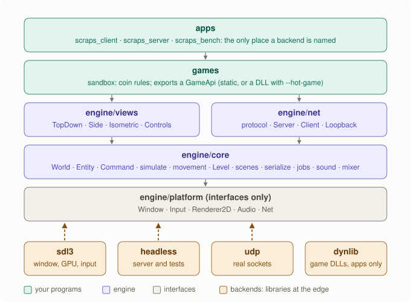

<details><summary>Text version</summary>

```text
┌──────────────────────────────────────────────────────────────────────┐
│ apps/        scraps_client  scraps_web  scraps_server  scraps_bench  │  the only place a
│              (wires everything; names concrete backends)             │  backend is named
├──────────────────────────────────────────────────────────────────────┤
│ games/       sandbox: coin rules; exports a GameApi                  │
│              (linked statically, or a DLL with --hot-game)           │
├───────────────────────────────┬──────────────────────────────────────┤
│ engine/views                  │ engine/net                           │
│  TopDownView SideView         │  protocol  Server  Client            │
│  IsometricView  Controls      │  LoopbackHub (in-memory network)     │
├───────────────────────────────┴──────────────────────────────────────┤
│ engine/core   World  Entity  Command  simulate  movement  Level      │
│               Scene loader  serialization  FixedStepClock  jobs      │
│               sound (decoding)  music (streaming)  mixer  save       │
├──────────────────────────────────────────────────────────────────────┤
│ engine/platform   Window Input Renderer2D Audio Net UiHost (interf.) │
└──────────────────────────────────────────────────────────────────────┘
        ▲ implemented by engine/backends:  sdl3   webview2   headless   udp
          (engine/backends/dynlib loads game DLLs; only apps use it)
```

</details>

Arrows only point down. Each layer is its own CMake library that links only
what is below it, and the `layer_rules` test (`cmake/CheckLayers.cmake`)
rejects any `#include` that points the wrong way or pulls SDL or socket
headers into the wrong place.

`views` and `net` sit side by side and never include each other. The server
needs movement rules, which belong to views (Rule 4), so the server's app asks
`views` for them when it builds the world, and the client receives them from
the server in the Welcome message. The server is the authority on rules too.

## 2. The world is plain data (Rules 1 and 5)

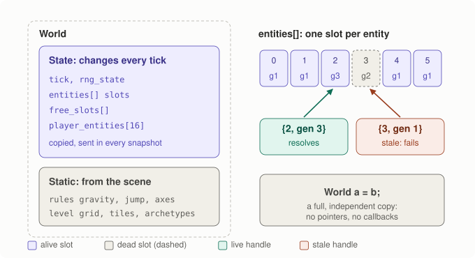

<details><summary>Text version</summary>

```text
World
 ├─ tick, rng_state                    ┐
 ├─ entities[]   (slots: alive flag,   │  "state": changes every tick,
 │                generation, fields)  │  goes into every snapshot
 ├─ free_slots[]                       │
 ├─ player_entities[16]                ┘
 ├─ rules        (gravity, jump, axes) ┐  static: from the scene
 └─ level        (tile grid, tiles,    │  (rules from the server)
                  archetypes, spawns)  ┘

slots:   [0 g1] [1 g1] [2 g3] [3 dead g2] [4 g1] [5 g1]
handle {2, gen 3} → slot 2, generation matches → resolves
handle {3, gen 1} → slot 3 is generation 2     → stale, does not resolve
```

</details>

- No pointers, no callbacks, no `std::string`: `World a = b;` is a complete,
  independent copy. That one property gives us interpolation (keep last tick),
  prediction (copy, then replay), save files and tests.
- Entities point at each other with `EntityId {index, generation}`. Destroying
  an entity bumps its slot's generation, so stale handles fail to resolve
  instead of pointing at whatever reuses the slot.
- The entity model is "array of structs" ([decision](decisions/2026-11-12-entity-model.md)):
  one `Entity` struct with every component field plus `flags`, and four
  `user` integers for game data.

## 3. Only `simulate` changes the world (Rule 1)

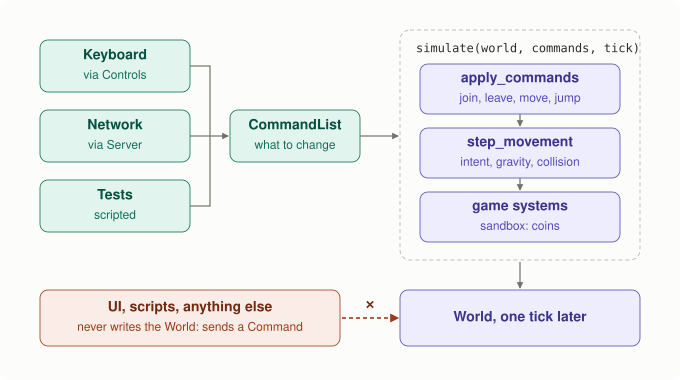

<details><summary>Text version</summary>

```text
 keyboard ──► Controls ──┐
 network  ──► Server ────┼──► CommandList ──► simulate(World&, commands, tick)
 tests    ───────────────┘                     │ apply_commands  (join, leave, move, jump)
                                               │ step_movement   (intent, gravity, collision)
                                               │ game systems    (sandbox: coins)
                                               ▼
                                             World, one tick later

 UI, scripts, anything else ──✗──► World     (they send a Command instead)
```

</details>

A game passes its own `simulate` (a plain function pointer) to `Server` and
`Client`; it calls `scraps::simulate` and then its own rules. Game commands use
`CommandType` values from 256 up (`game_command(n)`); the engine ignores them.

Building the first World from a scene (`make_world`) is construction, not
mutation. After that, nothing else writes to it.

**The mouse** ([spec](specs/2026-11-12-mouse-and-hot-reload.md), Part A) follows
the same path as keys. `Input` reports the pointer in render pixels, plus
buttons and the wheel, once per frame. `Controls::sample` turns a click into a
world point with `View::screen_to_world`. Each View inverts its own projection
onto its own plane through the player, so core still never learns which way is
down (Rule 4). The click is latched and sent once at the next tick as a
`Command` whose `vec` is that point. The game's `simulate` treats the point as
a request and checks it on the server (the sandbox's `place_coin` checks reach,
walls and the grid). The wheel and the hover outline only change what is drawn.

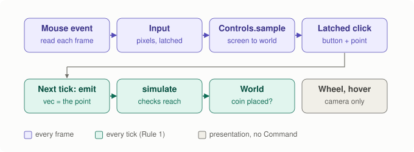

<details><summary>Text version</summary>

```text
SDL event ──► Input (pixels) ──► Controls::sample(input, view, camera, player)
                                    │  click? → View::screen_to_world → latch {button, world point}
                                    ▼
                        next tick: Controls::emit → Command{type, player, vec = world point}
                                    ▼
                        simulate (server is the authority: checks reach, may refuse)
```

</details>

## 4. Fixed steps, free rendering (Rule 2)

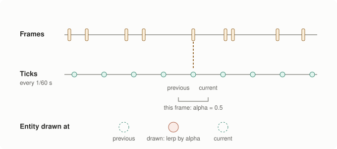

<details><summary>Text version</summary>

```text
real time  ──┬───────┬──┬────────────┬─────┬──►   frames: whenever the GPU is ready
             │       │  │            │     │
sim ticks  ──●───●───●───●───●───●───●───●───►   ticks: exactly every 1/60 s
                             ▲      ▲
                       previous   current     render at alpha = leftover / step
```

</details>

`FixedStepClock::advance(frame_seconds)` returns how many ticks to run. The
renderer draws entities at `lerp(previous, current, alpha)`. After a stall,
at most 8 ticks run per frame and the rest is dropped, so the game slows
down instead of freezing.

## 5. One grid, three views (Rule 4)

The level is a 3D grid of unit cubes ([decision](decisions/2026-11-12-level-model.md)).
Each View is a different camera on the same data:

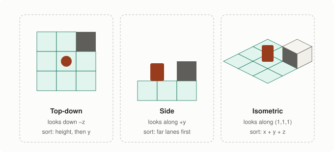

| | looks along | screen x | screen y | gravity | locked axis | draw order (back → front) |
|---|---|---|---|---|---|---|
| TopDownView | −z | x | y | none | z (no jump) | top surface height, then y |
| SideView | +y | x | −z | −z | y (lane) | farther lanes first; lanes in front are cut away |
| IsometricView | (1,1,1) diagonal | (x−y)·½ | (x+y)·¼ − z·½ | −z | none | x+y+z |

Why isometric sorting by `x+y+z` works: moving by (1,1,1) does not change the
screen position, so (1,1,1) is the view direction and `x+y+z` is depth. Unit
cubes with the same sum lie on one plane facing the camera and never overlap
on screen, so drawing in increasing sum is a correct painter's order for
blocks. Entities use the sum at their feet plus ½; boxes that straddle cells
can still sort wrongly against tall neighbours, the classic limit of sorting
whole objects.

`View::draw` collects one item per visible block and entity, sorts them with
`std::sort` (in place, no allocation), and turns them all into triangles.
Consecutive triangles that use the same texture form one batch, and each batch
is one `fill_triangles` call. Painter's order must be kept, so a batch ends
whenever the texture changes: a top-down crowd scene is 2 calls, an isometric
one where sprites and textured blocks interleave about 120.

**Textures and sprites** ([decision](decisions/2026-11-12-images-and-sprites.md)).
`Renderer2D` gained `create_texture` and texture coordinates per vertex. The
`SpriteBank` (views layer, client only) loads a level's PNGs into textures.
Every block face is a parallelogram on screen in all three views, so two
textured triangles map a square tile image onto it exactly. Entities with a
sprite are drawn as an upright picture on their feet, in the same depth slot
the box would have used, so blocks in front still cover them.

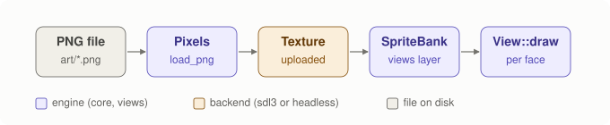

<details><summary>Text version</summary>

```text
image file ──load_png (core, stb_image)──► RGBA pixels ──create_texture (backend)──► TextureId
                                                                        ▲
            SpriteBank (views) keeps ImageIndex → TextureId ────────────┘
            View::draw asks it per tile face / per sprite, frame from the tick
```

</details>

**Sky, facing and shadows** (`docs/specs/2026-11-12-hardening-and-look.md`).

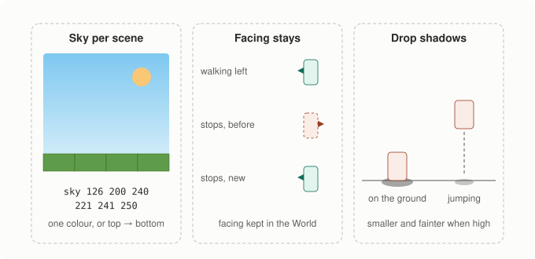

<details><summary>Text version</summary>

```text
sky per scene                  facing stays                     drop shadows
┌──────────────┐               walking left   ◄█                      █   jumping
│ sky colour   │  top          stops, before   █►  (snapped back)     ┊
│   ↓ blend    │               stops, now     ◄█  (kept)        █     ┊
│ bottom colour│  bottom                                    ────▄▄────▂──── ground
└──────────────┘                                            on the ground: full shadow;
sky R G B [R G B]                                           higher: smaller, fainter
```

</details>

- **Sky:** `Level::sky_top` and `sky_bottom` (scene line `sky`); `draw_sky`
  (views) fills the screen with one quad whose corners carry the colours.
- **Facing:** `Entity::facing` is a ground-plane direction (like
  `move_intent`), set by `simulate` (`update_facing` in `step_movement`) from
  a player's intent or anything else's velocity, and kept when it stops.
  Each view decides whether that direction is left or right on its screen
  (Rule 4), and mirrors the sprite.
- **Shadows:** `ground_below` (views: "down" is a view's business) finds the
  top of the highest solid block under the feet. Each entity gets a shadow
  draw item, smaller and fainter the higher the entity is, gone at 4 units.
  Top-down puts all shadows of one floor in a row (one batch); side view
  draws a flat ellipse, since a circle on the ground is a line from the side.

Input goes through the view too: `screen_to_ground_direction` turns "W means
up on screen" into the world direction that looks like up in that view.

**An open question for the owner (Rule 4).** `MovementRules` lets a view
choose the gravity vector, the jump speed and the locked axes, but core still
treats +z as "up" in three places: an entity is `on_ground` only after a hit
moving in −z, Jump sets `velocity.z`, and `cell_at_point` (the cell a mouse
click means) nudges z up by 1e-3 so feet on a block top pick the open cell
above it. That follows the constitution's
definition of z as "height above the ground plane", so today every view with
gravity pulls along −z. If a future view needs gravity along another axis,
ground detection and jumping must move into `MovementRules` (an "up" vector).

## 6. Server, client, prediction (Rule 5)

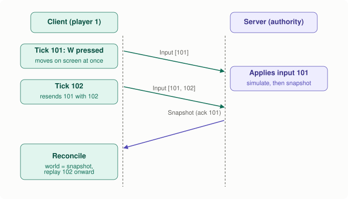

<details><summary>Text version</summary>

```text
client (player 1)                                   server (the authority)
─────────────────                                   ──────────────────────
tick 101: keys → Move ──► [seq 101] ──── Input ───► queue 101 ─┐
          predict: simulate locally                            │ tick: apply queued
tick 102: … [seq 101,102] (resends unacked) ─────►             │ inputs, simulate,
                                                               ▼ snapshot
          ◄──────── Snapshot(state, ack = 101) ──────────── fragments × N
reconcile: world = snapshot state
           re-simulate inputs 102.. (not yet acked)
```

</details>

- **Joining is three steps** (protocol version 4). A first Hello gets only a
  13-byte Challenge with a cookie, and the server keeps nothing. A Hello that
  echoes the cookie reserves a slot and gets the Welcome. The player's entity
  is created, and snapshots start, when that address sends its first Input.
  Joins and leaves are per-slot flags, applied at the next tick (leave
  first), so they can never be lost.

  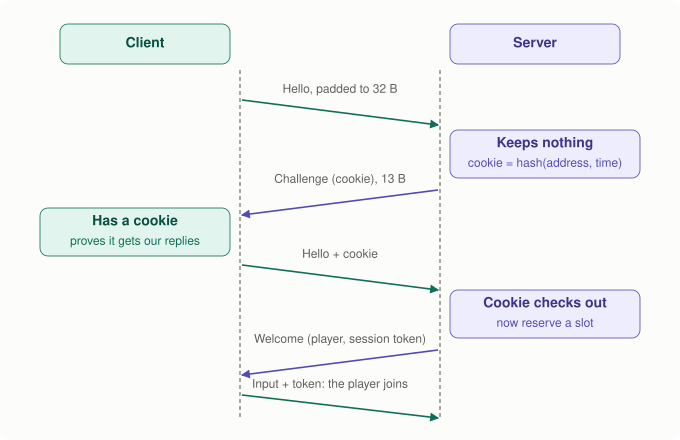

  <details><summary>Text version</summary>

  ```text
  client                                          server
  Hello (no cookie, padded to 32 B) ───────────►  keeps nothing
                   ◄─────────── Challenge (cookie), 13 B
  Hello + cookie ──────────────────────────────►  cookie checks out → reserve a slot
                   ◄─────────── Welcome (player, session token)
  Input + session token ───────────────────────►  the player joins
  ```

  </details>

  The cookie is `SipHash-2-4(secret, ip, port, now / 2 s)` (`net/cookie`), so
  only an address that receives the server's packets can echo it: a forged
  Hello (spoofed source address) gets one reply smaller than itself and no
  slot. The secret is random per run (`ServerConfig::cookie_secret`, chosen
  by the app; a server left without one lets nobody in); the server still
  never reads the clock.
- **The session token.** The Welcome carries a 64-bit token, and every Input
  and Bye starts with it. Only the address that received the Welcome knows
  it, so someone who fakes a player's address cannot move them, disconnect
  them, or keep a vanished player's slot alive: datagrams without it are
  dropped and counted, and only datagrams with it keep a slot alive. A Hello
  from a player's address needs a valid cookie too, and never refreshes the
  slot.
- **Rate limits** (`net/rate_limit`): replies to Hellos go through a token
  bucket per IP address (5 per second, burst 10; 64 addresses remembered) and
  one shared by all strangers (200 per second). Each connected client may
  send 480 datagrams per second (8 per tick, burst 64); extra ones are
  dropped and counted. Memory is fixed; nothing is allocated per packet.

  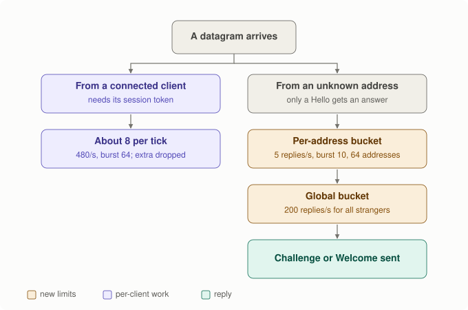

  <details><summary>Text version</summary>

  ```text
  datagram ─┬─ from a connected client ──► must carry its session token; ~8 per tick (480/s, burst 64)
            └─ from an unknown address ──► only a Hello gets an answer
                                            ├─ per-address bucket: 5 replies/s, burst 10 (64 addresses kept)
                                            └─ global bucket: 200 replies/s for all strangers
                                                └─► Challenge or Welcome
  ```

  </details>
- **Inputs** are tiny and sent every tick, each packet repeating the newest
  unacknowledged ticks (up to 8), so a lost packet is covered by the next one.
- **Snapshots** are the serialized world state, split into ≤1 KiB fragments.
  A newer snapshot replaces an incomplete older one.
- **Delta snapshots** (protocol version 3). Each Input also says which
  snapshot the client holds (its *acked snapshot*). The server keeps the last
  32 world states (`WorldState`, the World minus its level) and sends each
  client only the changes since its acked one; the client keeps the 32 states
  it rebuilt and applies the changes to the one named:

  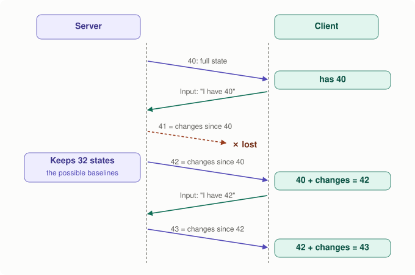

  <details><summary>Text version</summary>

  ```text
  server                                             client
  snapshot 40 (full) ─────────────────────────────►  has 40
                       ◄──────── Input (…, "I have 40")
  snapshot 41 = changes since 40 ──────── lost ✗
  snapshot 42 = changes since 40 ─────────────────►  40 + changes = 42
                       ◄──────── Input (…, "I have 42")
  snapshot 43 = changes since 42 ─────────────────►  42 + changes = 43
  ```

  </details>

  A lost snapshot costs nothing: the next one is still against a state the
  client has, and nothing is ever resent. A client with no ack yet (just
  joined or reloaded), or whose ack fell out of the 32-state window, gets a
  full snapshot. Each changed entity carries a 1-byte mask of the field
  groups that changed (slot, pose, motion, control, look, game data), so a
  moving entity costs ~14 bytes instead of ~83. The encoding is lossless:
  the client's rebuilt state is byte-for-byte the server's, so prediction
  starts from exactly the right numbers. A delta starts with its baseline's
  tick and is refused over any other baseline. Code: `write_world_delta` /
  `read_world_delta` in `core/serialize` (pure bytes), the rings in
  `net/server` and `net/client`. Spec: `docs/specs/2026-11-12-delta-snapshots.md`.

  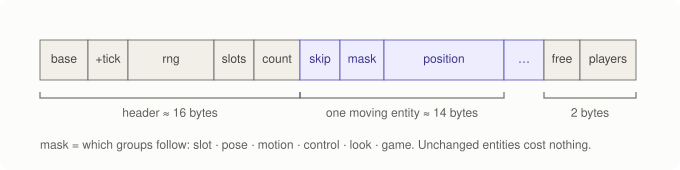

  <details><summary>Text version</summary>

  ```text
  | base tick u32 | +ticks varint | rng u64 | slots varint | count varint |   header ≈ 16 B
  | skip varint | mask u8 | changed groups (pose = 12 B) | …                |   ≈ 14 B per moving entity
  | free list flag | player table flag |                                     2 B when unchanged
  mask bits: slot · pose · motion · control · look · game
  ```

  </details>
- **The server never trusts a client**: it rewrites the player id of every
  command to the sender's, drops server-only commands (join, leave), and
  applies at most 6 commands per client per tick, so no client can crowd out
  the others.
- **The client does not blindly trust the server either**: snapshot values
  are bounded (sizes, coordinates, speeds; the free list must be exactly the
  dead slots), so a broken or hostile server cannot hang or crash it.
- **Catching up.** If a client's inputs pile up on the server (its clock runs
  a little fast, or packets came in a burst), the server applies two input
  frames in one tick. The client predicted those as two ticks, so it sees a
  one-tick correction. That is the price of keeping latency from growing.
- **Prediction** makes the local player respond at once; **reconciliation**
  quietly corrects it to the server's truth when a snapshot arrives.
- **Offline** = the same `Server` inside the client, connected by a
  `LoopbackHub` instead of UDP. There is no separate single-player code path.
- **Other players are interpolated, not predicted.** Their inputs are unknown
  on this machine, so predicting them means guessing, and a guess overshoots
  when they stop. Instead the client keeps the last 16 snapshots' player
  positions and draws other players 4 ticks (~67 ms) in the past, between
  two real snapshots:

  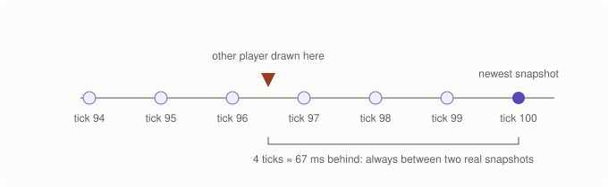

  <details><summary>Text version</summary>

  ```text
  snapshots:  ●──────●──────●──────●──────●   newest (tick 100)
                      ▲
          drawn here: newest − 4 ticks (≈ 67 ms) → always between two known points
  ```

  </details>

  `Client::display_world(alpha)` builds the frame's picture: the local player
  and everything else predicted (blended by alpha), other players
  interpolated. It is a render-only copy; nothing simulates it.
- **Hot reload.** `Server::reload` swaps in a world built from the edited
  scene (keeping the tick number), re-joins every player, and sends everyone
  a new Welcome. Snapshot fragments carry the scene hash (since protocol
  version 2), so a client that missed that Welcome notices the mismatch and
  asks again. Both sides forget their kept states on a reload, so the first
  snapshot of the new world is a full one.

Not yet done (see the [plan](plan.md)): relevance (sending far-away entities
less often, part B of the delta spec; the owner chose to leave it open until a
game needs it), lag compensation (to be specced with the first game that has
fast player-versus-player hits).

## 6b. The job system (stage 8)

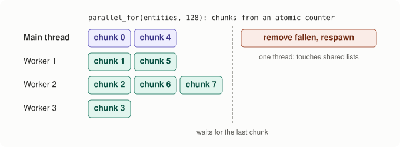

<details><summary>Text version</summary>

```text
main thread                         worker threads (cores − 1, started once)
  simulate → step_movement
    parallel_for(entities, 128) ──►  each thread: chunk = next++ (atomic)
    (the caller takes chunks too)     move entities [chunk·128, +128)
    waits for the last chunk ◄────────┘
  then, on one thread: remove fallen entities, respawn players
```

</details>

- **Why it is safe:** during one tick, each entity's movement reads only the
  level (which never changes during a tick) and writes only that entity.
  Removing entities touches the shared free list, so it runs afterwards on
  one thread, in index order. The result is byte-for-byte the same as
  single-threaded (`core.threaded_simulate_matches_single_threaded`).
- **How the threads coordinate:** a mutex and condition variable wake the
  workers for a new job; an atomic counter hands out chunks, one
  indivisible `fetch_add` each, so no chunk runs twice. The caller also waits
  until every worker has left the job before starting the next one, so a
  slow worker can never mix two jobs up. No allocation per call.
- **The lesson, measured:** `scraps_race_demo` increments one counter from
  every core. With `std::atomic` it is exact; with a plain variable (LOAD,
  ADD, STORE) it lost about 70% of 16 million updates on the 8-thread
  development machine.
- `simulate` receives the job system as an optional fourth parameter, a
  accepted decision ([simulate-jobs](decisions/2026-11-12-simulate-jobs.md)).

## 6c. Sound

Decision: [audio formats](decisions/2026-11-12-audio-formats.md).

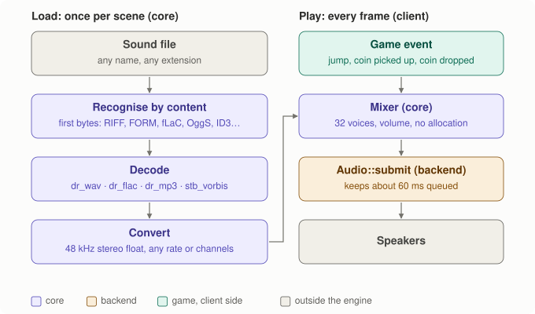

<details><summary>Text version</summary>

```text
load (once per scene, core)                          play (every frame, client)
sound file (any name or extension)                   game event: jump, coin picked up, coin dropped
  ▼ recognise by the first bytes                       ▼ SoundBank::play("coin")
  ▼ decode: dr_wav · dr_flac · dr_mp3 · stb_vorbis   Mixer (core): 32 voices, volume, no allocation
  ▼ convert to 48 kHz stereo float ────────────────►   ▼
                                                     Audio::submit (backend): keeps ~60 ms queued
                                                       ▼ speakers
```

</details>

- **Any common format** (WAV, AIFF, FLAC, MP3, OGG Vorbis), recognised by its
  first bytes, never by its name (`detect_audio_format`). Opus, AAC and WMA
  are recognised and refused with an error that names them.
- **One shape for every sound:** `decode_sound` converts any rate and 1 to 8
  channels to 48 kHz stereo float at load time. More than two channels are
  mixed down with a table (centre and surround to both sides at −3 dB, LFE
  left out); Vorbis files are reordered to the WAV channel order first.
- **The engine mixes, the backend plays.** `Mixer` (core) owns the decoded
  sounds and up to 32 voices; `mix()` allocates nothing. The client mixes
  about 60 ms ahead each frame and calls `Audio::submit` (Rule 3): no
  audio-thread callbacks, no locks.
- **Presentation only** (Rule 1). The game turns two worlds a tick apart
  into sound names (`sandbox::sound_events`: jump, coin, drop) and the
  client's `SoundBank` plays them; nothing in the World changes.

## 6d. Games as modules, and hot reload

([decision](decisions/2026-11-12-game-modules.md), [spec](specs/2026-11-12-mouse-and-hot-reload.md), Part B)

A game describes itself to the apps with one plain struct, `GameApi`
(`engine/core/game_api.h`). It holds the game's `simulate`, its key and
mouse bindings, a function that turns two worlds into sound names, and one
that writes the HUD text. The apps never name a game directly. Release
builds link the game statically. With `--hot-game`, the client (offline)
or the dedicated server loads the same game as a DLL instead, and swaps in
each new build while it runs.

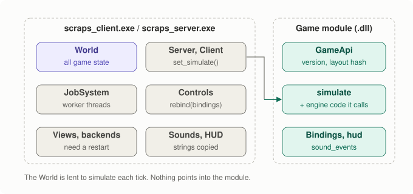

<details><summary>Text version</summary>

```text
┌──────────── scraps_client.exe / scraps_server.exe ─────────────┐     ┌──── scraps_sandbox_module.dll ────┐
│ owns all state: World, Server, Client, JobSystem, views,       │     │ code only, no state:              │
│ backends, Controls, SoundBank                                  │     │   GameApi { simulate, bindings,   │
│                                                                │     │             sound_events, hud }   │
│ each tick:  simulate(world&, commands, tick, jobs) ────────────┼────►│   (+ its own copy of the engine   │
│             (the World is lent, never kept by the module)      │     │    code it calls, e.g. movement)  │
└────────────────────────────────────────────────────────────────┘     └───────────────────────────────────┘
 nothing in the exe keeps a pointer into the module across a swap; strings are copied on load
```

</details>


<details><summary>Text version</summary>

```text
cmake --build --preset mingw-game        (builds only the selected game's module)
        │
FileWatcher sees the .dll change, waits until it is stable (linker finished)
        │
copy to scraps_sandbox_module.live-N.dll  (Windows locks loaded DLLs; the original stays writable)
        │
load copy → scraps_game_api() → api_version and layout hash match?
        │ no ──► keep running the old code, HUD says why
        │ yes
between two frames (no tick, no job running):
   server.set_simulate   client.set_simulate   controls rebound
        │
unload the previous copy
```

</details>

- **Why it is safe:** `World` is plain data with no pointers or callbacks
  (Rule 5's consequence), so the exe can lend it to new code and nothing
  dangles. The DLL loader is a backend (`engine/backends/dynlib`), so
  `windows.h` stays out of core and apps.
- **What reloads:** game code, and the copy of engine code the module calls
  (movement, for example). **What doesn't:** anything in the exe (views,
  net, backends, apps). The layout hash includes a SHA-256 of every
  `engine/core` and `engine/platform` header plus `core/jobs.cpp` and
  `core/world.cpp` (`cmake/ScrapsBoundaryHash.cmake`). Editing any of them,
  even only a comment, makes the old exe refuse the new module ("restart the
  program") instead of crashing.
- **The loop:** start `scraps_client --hot-game`, edit `games/sandbox/*.cpp`,
  run `cmake --build --preset mingw-game` (about a second), and the running
  game picks it up.

## 6e. Saving, loading and pausing

([spec](specs/2026-11-14-offline-essentials-and-ui.md), Parts 1 and 4)

- **A save is the World's state**, written the same way as a snapshot
  (`write_world_state`). Its header holds:
  - magic `SCRS` and the save format version;
  - the world format version;
  - the scene name and content hash;
  - the tick and the game's name;
  - a checksum.
  The level is not stored; it comes from the scene file. Loading starts from
  the World built from the scene and lays the saved state over it
  (`core/save.h`). A truncated, damaged or other-version file, another game's
  save, or another scene's is refused; a changed scene file loads with a
  warning.
- **The server saves and loads** (Rule 5). Offline that is the embedded
  server. `Server::load_state` replaces the World between ticks, like a
  scene reload (construction, not mutation). It starts a new **world epoch**,
  sent in every snapshot (protocol v5), so clients reset prediction and
  interpolation whether the loaded tick is earlier or later.
- **Where:** offline, F5 and F9 use `quick.sav` in `SDL_GetPrefPath("Scraps",
  <game>)` (`%APPDATA%\Scraps\<game>\`), or `saves/` when headless. The
  dedicated server has `--load` and `--save`; `--save` runs on a clean stop
  only.
- **Pause** is offline only. P, gamepad start or the pause menu stop the
  embedded server and the client together: no ticks, no inputs and no
  snapshots, with timeouts frozen on both sides. Frames keep drawing, and the
  music ducks to 40%. On resume the step clock is reset, so no burst of
  catch-up ticks runs (Rule 2). Input pressed while paused or in a menu is
  thrown away.

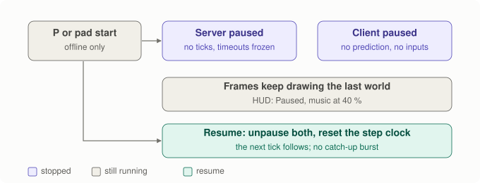

<details><summary>Text version</summary>

```text
P / gamepad start / pause menu ─► paused
paused:   server: no ticks, no snapshots, timeouts frozen
          client: no prediction, no inputs, server timeout frozen
          frames keep drawing the last world; music at 40 %
resume:   both unpause, clock.reset()  ─► the next tick follows (no burst)
```

</details>

## 6f. Music, gamepad and the input event list

- **Music** streams: `MusicStream` (`core/music.h`) keeps the encoded file in
  memory (up to 64 MB) and decodes a few thousand frames at a time with the
  same vendored decoders as sound effects. A scene line `music <path>
  [volume V]` plays it, crossfading when the track changes and continuing
  across a hot reload. The mixer has a music channel with its own volume.
  Mixing allocates nothing. A pre-check of every OGG comment header keeps a
  damaged file from crashing stb_vorbis.
- **The gamepad** comes through `Input`: the first connected pad, with
  positional button names (south = A on Xbox), raw axes, and buttons latched
  per frame like keys. `Controls` maps the left stick through the View, as it
  does WASD (Rule 4), with a radial dead zone of 0.2. `GameBinding` can name a
  pad button (`GameApi` v2).
- **The event list:** `Input::events()` is every key, text, pointer and pad
  event of the frame in order, with fixed capacity (256), for UI text fields.
  The polling API is unchanged.

## 6g. The UI layer: React in a WebView2 window

([decision](decisions/2026-11-14-ui-layout.md), [spec](specs/2026-11-14-offline-essentials-and-ui.md), Part 6)

`scraps_web.exe` is the client with a React UI. A Win32 window hosts WebView2.
The world is drawn by WebGL2 in the page, from the same triangle batches the
Views already make, and React draws the menus and HUD on top. `scraps_client`
(SDL) is unchanged and still has the debug HUD.


<details><summary>Text version</summary>

```text
native (scraps_web.exe)                                page (WebView2, https://scraps.ui/)
ClientApp::frame  (simulate, net, audio, Views)
  ▼
Renderer2D (webview2): textures + batches as bytes ─shared buffer─► renderer.js: WebGL2 on canvas#world
UiHost: view JSON (only when it changes) ───────────────────────────► React (ui/): menus, HUD, Esc
UiModel ◄── actions {name: play|pause|save|...|command} ◄────────────┘
Input   ◄── keys, mouse, wheel, text (only while playing; never Esc) ◄ page input
```

</details>

- **One frame** is one byte stream, with textures (sent once) and then
  batches in painter's order. It goes through an `ICoreWebView2SharedBuffer`
  with a 20-byte note per frame; there is no JSON per vertex. The page draws
  top row first into an offscreen texture, so the result matches the SDL
  client pixel for pixel (top-down 100%, side and isometric over 99.9%; the
  rest is a coin's animation frame).
- **Messages** use the protocol in spec section 6a:
  - views go to the page when they change;
  - actions come back: `play`, `continue`, `pause`, `resume`, `save`, `load`,
    `quit`, volumes, settings, and `command`;
  - a `command` names a `GameApi::ui_commands` entry (v3) and becomes a
    `Command` at the next tick (Rule 1); the rest are app actions;
  - native parses everything with fixed limits, ignores other origins,
    blocks navigation away (the page's and its iframes'), and counts
    anything malformed;
  - notices are short and name no paths ("saved", "load failed: there is no
    save yet"); the console and the debug HUD keep the full text. The same
    notice twice in a row is sent with an empty one between, so it shows again.
- **Esc belongs to the page** (playing → pause menu → resume). Online the
  same menu opens over a game that runs on (Resume, Settings, Quit). P and
  gamepad start are native. One press toggles once, even if the page's
  message arrives late. UI game buttons pressed before a pause, a menu or a
  load are dropped with the latched keys.
- **Pacing:** the page asks for a frame after each `requestAnimationFrame`,
  and only a frame that answers such a request is recorded and sent. If none
  comes for 20 ms (window hidden or minimised), a frame runs anyway, so
  ticks, network and sound keep going, but it sends the page nothing. The
  20 ms is measured by `scraps_web`'s loop: the backend reads no clock
  (Rule 2) and gets the app's as a function for its start-up waits.
- **Textures** too big to go in one frame beside its draws (a burst past the
  64 MB slot) go over the next frames, whole ones in order; the page draws a
  missing texture flat meanwhile.
- **Sound and gamepad** come from SDL with no SDL window (`sdl3_devices`), so
  the webview2 backend itself has no SDL dependency.
- **Building:** the WebView2 SDK is a pinned NuGet package (BSD-3-Clause;
  the release ships its licence as `licenses/WebView2.txt`). MSVC uses the
  static loader; MinGW loads `WebView2Loader.dll` at run time from the exe's
  folder only, and ships it. CMake runs `npm ci` and `npm run build` in `ui/`
  when npm is found, through `cmake/ScrapsNpm.cmake`, which holds a lock on
  `ui/.npm.lock` so two presets building at once take turns.
  `ctest -L window` runs a real-window self-test that clicks Play, draws
  120 frames and checks the canvas (its WebView2 profile stays in the build
  folder), and `package_web_runs` does the same with the installed
  `scraps_web.exe`. Both report "skipped" without the runtime or without a
  desktop to draw on (a service, a locked or disconnected session).
- **Development builds only:** DevTools, F12 and browser keys, the
  build's `ui/dist` as a fallback, and `--ui-dev <url>` (a dev server on
  this PC: localhost, 127.0.0.1 or [::1]).

## 6h. Choosing the game, and shipping it

- **One option picks the game:** `-DSCRAPS_GAME=<name>` (default
  `sandbox`). Each game calls `scraps_add_game(<name> SOURCES ... SCENES
  <dir>)` (`cmake/ScrapsGame.cmake`), which makes its static library, its
  hot-reload module and its scene settings. The apps get the chosen game's
  `GameApi` from a generated header and never name a game.
- **Scenes at run time:** `--scene-dir`, then `scenes/` next to the exe, then
  (development builds only) the source folder.
- **A release** is `cmake --workflow --preset release-mingw` (or
  `release-msvc`): configure, build, test and package. The zip holds:
  - `scraps_client.exe`, `scraps_web.exe` and `scraps_server.exe`;
  - the compiler runtime DLLs and `WebView2Loader.dll` (MinGW);
  - `ui/`, `scenes/`, `licenses/` (SDL3's zlib licence and the WebView2
    SDK's BSD-3-Clause licence) and a `README.txt`.
  SDL3 is linked statically. Release builds link the game statically and have
  no hot reload. `package_runs` installs it and runs it with `PATH` cut to
  Windows' own folders, and also from a folder with a non-ASCII name.

## 7. Where time and memory go

`scraps_bench` measures it (crowd scene, 1,001 entities; MinGW Release,
`release-mingw` preset, game linked statically; Core i5-1135G7, GCC 13.1;
2026-11-14, commit `e1db360`; machine idle, at most 6% CPU. With other builds
running, expect about twice these averages. Your numbers will differ):

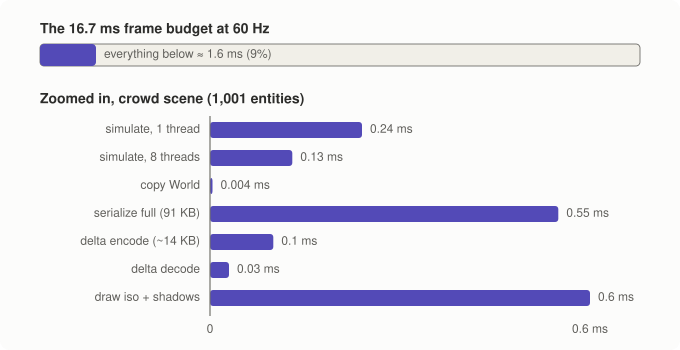

| Step | avg |
|---|---|
| simulate, 1 thread | ~0.15 ms |
| simulate, 8 threads | ~0.08 ms |
| copy World (previous = current) | ~0.002 ms |
| serialize full snapshot (91 KB) | ~0.35 ms |
| delta snapshot, encode / decode (~14 KB, 6 ticks behind) | ~0.06 ms / ~0.017 ms |
| View::draw, isometric, textured, with shadows (CPU side) | ~0.39 ms, 1,199 batches |
| View::draw, side, textured, with shadows | ~0.19 ms, 1,115 batches |
| View::draw, top-down, textured, with shadows | ~0.14 ms, 3 batches |
| mixing music, per frame (~16.7 ms of audio) | ~0.012 ms (60 ms at once: ~0.04 ms) |
| `scraps_web` frame, isometric (record, encode, copy into the shared slot) | ~0.73 ms, 0.66 MB (all 1,001 on screen: ~1.4 ms, 1.25 MB) |

Everything together (one thread) is about 6% of the 16.667 ms frame budget
(~0.96 ms). The 2026-11-12 numbers, about 60% higher, were taken with other
builds running: the older code, re-run idle on the same machine, gives the
same figures as above, so it was background load, not `facing`. The crowd's
batch counts moved slightly because the random seed follows the scene file's
hash, and `crowd.scene` gained a `music` line. In `scraps_web`, recording the
vertices is 90% of a frame's native cost; encoding and copying are under
0.11 ms. A headless `--hot-game` client shows no measurable per-tick cost from
calling `simulate` in a DLL (+~40 ms at startup).
Shadows cost the most new time: in side and isometric views each shadow sits
between two sprites in painter's order, so the crowd scene needs about 1,200
batches instead of about 120 (top-down groups them into one). The threads
only halve an already small number here; they matter as worlds grow.

Snapshot sizes per client (payload; `scraps_bench`, the player walking):

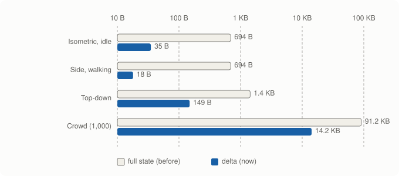

| Scene | Full | Delta | At 60 Hz, per client |
|---|---|---|---|
| isometric / side | 694 B | ~20 B | ~1.2 KB/s (was 42 KB/s) |
| top-down (8 critters always moving) | 1,431 B | ~150 B | ~9 KB/s (was 86 KB/s) |
| crowd (1,000 wanderers) | 91,239 B | ~14,200 B | ~0.85 MB/s (was 5.5 MB/s) |

Full snapshots grew by 8 bytes per entity when entities gained `facing`;
deltas barely changed (facing rides with the control group).

The crowd scene is still heavy because everything in it moves every tick:
that is what relevance (part B) would address.

`scraps_alloc_test` replaces `operator new` and fails if 300 ticks of
threaded simulate + world copy + delta encode/decode + mixing + mouse
sampling and picking + polling a game module + all three textured views with
shadows allocate anything after warm-up.
