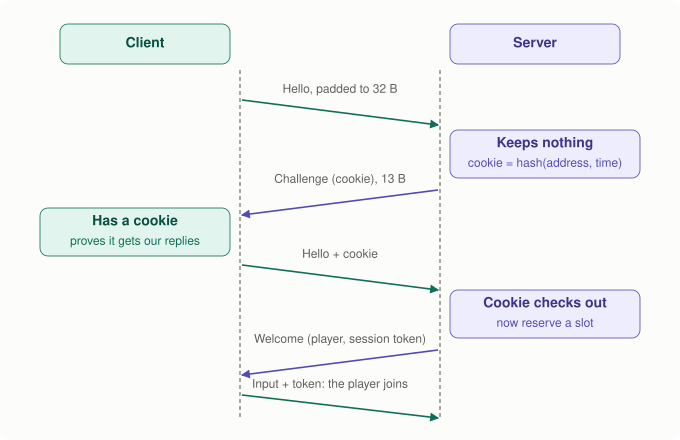
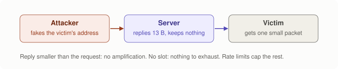
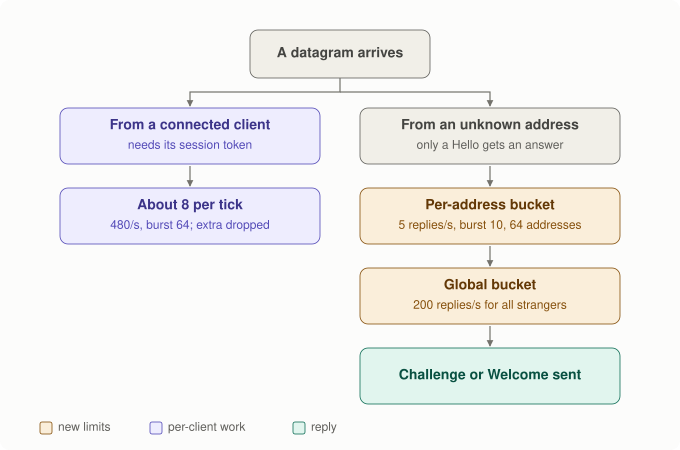
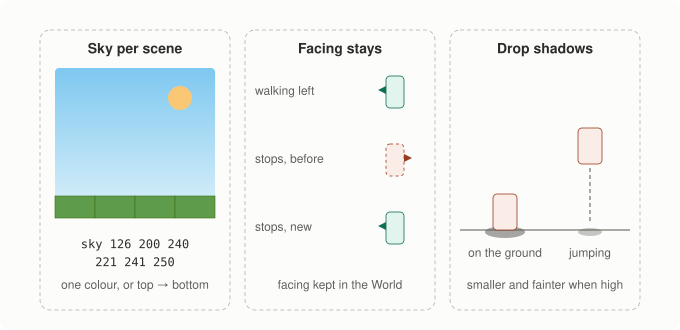
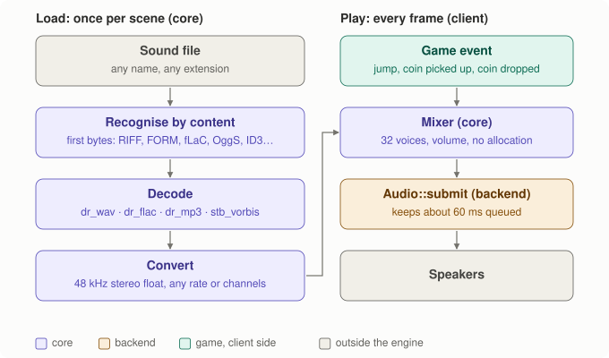

# Spec: internet hardening, and look and feel

- Date: 2026-11-12
- Status: **Approved and implemented (2026-11-12).** See "Results" at the end
  for what changed while building it (a session token, a token bucket).
- Plan items: `docs/plan.md`, "Next", items 2 (internet hardening) and 3 (look and feel).
- Diagrams: `tools/make_spec_diagrams.py` → `docs/images/spec-hl-*.svg`.

Two independent parts. Part 1 changes the network handshake (protocol
version 4). Part 2 is what the player sees and hears: sky, facing, shadows,
and sound effects from files in any common format.

---

## Part 1. Internet hardening

### The problem

Today a Hello reserves a player slot at once and gets a ~70-byte Welcome
back. Someone who fakes their source address can:

- make the server send Welcomes to a victim (small, but larger than the Hello);
- hold slots for 2 s each, so a stream of fake Hellos keeps real players out;
- flood the server with packets that each cost work.

On a LAN this does not matter. On the internet it does.

### 1a. A challenge cookie in the handshake



<details><summary>Text version</summary>

```text
client                                          server
Hello (no cookie, padded to 32 B) ───────────►  keeps nothing
                 ◄─────────── Challenge (cookie), 13 B
Hello + cookie ──────────────────────────────►  cookie checks out → reserve a slot
                 ◄─────────── Welcome (player, session token)
Input + session token ───────────────────────►  the player joins
```

</details>

- **The cookie** is a keyed hash of the sender's address and the time:
  `SipHash-2-4(secret, ip, port, now / 2 s)`. The server stores nothing per
  Hello; it recomputes the hash when the cookie comes back. A cookie is valid
  for the current and the previous 2-second window (2 to 4 s).
- **Why it works:** only someone who receives packets at that address can
  echo its cookie, so a faked address never gets past the Challenge.
- **No amplification:** a Hello must be at least 32 bytes (zero padding);
  the Challenge is 13. The server never answers a stranger with more bytes
  than it received.
- **The secret** is 128 random bits, chosen by the app at start
  (`ServerConfig::cookie_secret`; tests use a fixed one). The server still
  never reads the clock: time comes in through `poll(now)` as today.
- A Hello from an address that already has a slot is answered with its
  Welcome again, as today (that is how a client recovers a lost Welcome or
  a missed hot reload).



<details><summary>Text version</summary>

```text
attacker (fakes victim's address) ──Hello 32 B──► server ──Challenge 13 B──► victim
                                                  keeps nothing, no slot
```

</details>

### 1b. Rate limits



<details><summary>Text version</summary>

```text
datagram ─┬─ from a connected client ──► must carry its session token; ~8 per tick (480/s, burst 64)
          └─ from an unknown address ──► only a Hello gets an answer
                                          ├─ per-address bucket: 5 replies/s, burst 10 (64 addresses kept)
                                          └─ global bucket: 200 replies/s for all strangers
                                              └─► Challenge or Welcome
```

</details>

- **Token buckets.** A bucket refills at a steady rate up to its burst size,
  and each reply takes one token; no token, no reply. Per address (IP, any
  port) the default is 5 replies per second with a burst of 10, which covers
  a household of players behind one router joining together. All strangers
  together share 200 replies per second.
- **A fixed table of 64 addresses**, least recently seen replaced first, so
  memory is bounded and nothing is allocated per packet.
- **Connected clients** may send 480 datagrams per second, 8 per tick on
  average, with a burst of 64 so a client catching up after a stall is not
  cut off (a normal client sends 1 per tick); extra ones are dropped and
  counted. This bounds the work any one client can cause.
- All limits are `ServerConfig` fields with these defaults.

### What it does not protect against

Floods big enough to fill the network link itself (that needs protection
from the hosting provider), and attackers who can read the traffic between
a player and the server (they see the session token; that needs encryption,
which is out of scope). Attackers who only know a player's address can no
longer act as that player (see the session token in "Results").

### Interfaces

```cpp
// net/protocol.h: version 4
enum class MessageType : std::uint8_t { …, kChallenge = 7 };
constexpr std::size_t kMinHelloSize = 32;
void write_hello(std::vector<std::uint8_t>& out, std::uint64_t cookie);  // padded
void write_challenge(std::vector<std::uint8_t>& out, std::uint64_t cookie);

// net/cookie.h: SipHash-2-4, pure functions
std::uint64_t make_cookie(const CookieSecret&, const Address&, std::uint32_t time_window);

// net/rate_limit.h: fixed-size token buckets, no allocation
class RateLimiter { bool allow(std::uint32_t ip, double now); … };
```

### Tests (part 1)

- `net.forged_hello_gets_only_a_challenge`: no slot is reserved, and the only
  reply is a Challenge no larger than the Hello.
- `net.cookie_is_bound_to_address_and_time`: a cookie echoed from another
  port or address, or after 4 s, gets a fresh Challenge instead of a slot.
- `net.hello_flood_is_rate_limited`: 10,000 Hellos from one address in a
  second get at most 15 replies; a second address still joins meanwhile.
- `net.many_addresses_share_the_global_limit`: Hellos from 1,000 addresses
  get at most 200 replies per second in total.
- `net.input_flood_is_capped_per_client`: 100 datagrams per tick from a
  connected client; at most 8 are handled, and the other players are unaffected.
- Existing tests updated for the extra round trip (`reconnect_spam…`,
  `a_forged_hello…`, `wrong_protocol_version…`, the UDP test).

---

## Part 2. Look and feel



<details><summary>Text version</summary>

```text
sky per scene                  facing stays                     drop shadows
┌──────────────┐               walking left   ◄█                      █   jumping
│ sky colour   │  top          stops, today    █►  (wrong)            ┊
│   ↓ blend    │               stops, new     ◄█  (kept)        █     ┊
│ bottom colour│  bottom                                    ────▄▄────▂──── ground
└──────────────┘                                            on the ground: full shadow;
sky R G B [R G B]                                           higher: smaller, fainter
```

</details>

### 2a. Sky per scene

- New scene directive: `sky <r> <g> <b> [<r> <g> <b>]`. One colour fills the
  background; two colours blend from the top of the screen to the bottom.
- Stored in `Level` (`sky_top`, `sky_bottom`); without the line, today's dark
  blue-grey (24, 26, 34). The world format goes to version 3.
- Drawn by a small `draw_sky(level, renderer)` in `views`: one screen-sized
  quad with a colour per corner, before the world.
- The sandbox scenes get skies: light blue for side view, a dusk gradient
  for isometric, and a dark green-grey for top-down (seen around the level).

### 2b. Facing that stays when a character stops

Today a sprite flips to face left only while it moves left; when it stops,
it snaps back to facing right.

- `Entity` gains `Vec2 facing`: the last direction it moved in, on the
  ground plane (world x, y, length 1; starts as +x). It is gameplay state, not
  just looks (a later attack or "use" goes the way you face), so it lives in
  the `World` and is updated by `simulate` (Rule 1): in `step_movement`, from
  the move intent when there is one, else from the velocity when the entity
  is moving.
- Each `View` turns the world direction into "left or right on my screen"
  (Rule 4: the core does not know what left is), so a character that walked
  away from the camera in isometric view keeps the right side.
- Cost: 8 bytes per entity in a full snapshot; in deltas it rides in the
  control group, which only changes when a player presses keys.

### 2c. Drop shadows

- Every entity gets a soft dark ellipse on the ground below it: the top of
  the highest solid block under its feet. It is smaller and fainter the
  higher the entity is above that ground (gone at 4 units), so a jump reads
  clearly in side and isometric views.
- Drawn by the view, in the entity's own depth slot just before its sprite,
  so blocks in front still cover it. Top-down and isometric project a circle
  on the ground plane; side view draws a flat ellipse (a circle on the ground
  would be a line seen from the side).
- Pure drawing: nothing in the `World` changes. `scraps_bench` will show the
  cost; a shadow adds one flat-colour batch per entity in the worst case.

### 2d. Sound effects from any common format



<details><summary>Text version</summary>

```text
load (once per scene, core)                          play (every frame, client)
sound file (any name or extension)                   game event: jump, coin picked up, coin dropped
  ▼ recognise by the first bytes                       ▼ play("coin")
  ▼ decode: dr_wav · dr_flac · dr_mp3 · stb_vorbis   Mixer (core): 32 voices, volume, no allocation
  ▼ convert to 48 kHz stereo float ────────────────►   ▼
                                                     Audio::submit (backend): keeps ~60 ms queued
                                                       ▼ speakers
```

</details>

**Formats.** The loader accepts every common game-audio format and does
not care about file names or extensions; it looks at the first bytes:

| Format | Recognised by | Decoder (vendored, single file, public domain) |
|---|---|---|
| WAV: PCM 8/16/24/32-bit, float, ADPCM, A-law, µ-law; also W64, RF64 | `RIFF`, `RIFX`, `riff`, `RF64` | dr_wav |
| AIFF, AIFF-C | `FORM` | dr_wav |
| FLAC | `fLaC` | dr_flac |
| MP3 | `ID3` or an MPEG frame header | dr_mp3 |
| OGG Vorbis | `OggS` + Vorbis header | stb_vorbis |

Any sample rate and any number of channels are accepted: mono is spread to
both sides, more than two channels are mixed down, and everything is
resampled to 48 kHz stereo at load time, so playing a sound costs nothing.

Not included, with a clear error naming the format: **Opus** (needs the
libopus library, not a single file; can be added later), AAC/M4A and WMA
(patent-encumbered, need system codecs). The scene loader reports these
like any other asset error, and the game runs silent for that sound.

**Pieces.**

- `core/sound`: `decode_sound(bytes, size, out, error)`: detection, the four
  decoders, conversion. Pure bytes in, samples out, like PNG decoding.
  Limits: 32 MB per file, 30 s per sound.
- `core/mixer`: up to 32 voices playing at once, each with a volume; a new
  sound replaces the oldest voice when all are busy. `mix(out, frames)`
  allocates nothing. Pure, so tests check the exact samples.
- `Audio` interface (Rule 3): `play_tone` is replaced by
  `submit(const float* stereo, std::size_t frames)` and `queued_frames()`.
  The client mixes on its own thread each frame, enough to keep about 60 ms
  queued: no audio-thread callbacks, no locks. sdl3 feeds an SDL audio
  stream; headless counts frames.
- Scenes: `sound <name> <path> [volume V]`, paths as for images. A
  `SoundBank` (client only, next to `SpriteBank`) loads them and reloads
  them on hot reload.
- **Sounds are presentation only** (Rule 1): nothing in the World changes.
  The sandbox decides which events make which sound
  (`sandbox::sound_events(previous, current, player)`: jump, coin picked up,
  coin dropped), and the client plays them by name.
- Sandbox sounds come from a new `tools/make_sandbox_sounds.py`, like the art.

### Tests (part 2)

- `scene.sky_line_parses` (one and two colours, errors), and the world
  format round-trips with the sky.
- `core.facing_follows_movement_and_stays`: walk left, stop: still facing
  left; bouncing wanderers face where they go.
- `views.sprite_faces_the_way_it_last_moved` in all three views.
- `views.shadow_sits_on_the_ground_below`: under a jumping entity, the
  shadow is on the block top, and shrinks as the entity rises.
- `core.sounds_decode_from_every_format`: the same short tone stored as
  WAV (8, 16, 24-bit, float), AIFF, FLAC, MP3 and OGG decodes to 48 kHz
  stereo, with the right length and loudness. Files named with the wrong
  extension still decode. Opus and garbage give a clear error.
- `core.sound_rejects_hostile_input`: truncated and random bytes never
  crash any decoder (like the PNG fuzz test).
- `core.mixer_mixes_and_replaces_voices`: two sounds add up; volume scales;
  a 33rd sound replaces the oldest.
- `no_allocation_in_hot_path` extended with mixing and shadows.

### Rules check

| Rule | Effect |
|---|---|
| 1. Only `simulate` changes the World | Facing is set by `step_movement`. Sky, shadows and sound never touch the World. |
| 2. Fixed step | Unaffected. Sounds are triggered from ticks; mixing follows the frame. |
| 3. No backend in core | Decoders and the mixer are pure code in core; only `submit` reaches the backend. |
| 4. No "down" in core | Facing is a ground-plane direction like `move_intent`; each View decides what left is. Shadows (ground below = along −z) are computed in `views`. |
| 5. Server authority | The handshake is the server's; cookies are checked on the server. Facing is server state, predicted like the rest. |
| Code rules | No exceptions (the decoders are C), no allocation in mixing or drawing, nothing global (the secret is in `ServerConfig`). |

## Out of scope

Music streaming (long files decoded while playing), positional/3D sound,
encryption of game traffic, accounts or passwords, Opus.

## Questions for the owner

1. Approve both parts as written?
2. **Test files for the compressed formats.** No audio encoder is installed
   here, so I can only make WAV test files. May I install ffmpeg through
   MSYS2 (`pacman -S mingw-w64-ucrt-x86_64-ffmpeg`, a development tool only,
   not shipped) to create small FLAC, MP3, OGG and AIFF test files once?
   They would be committed under `tests/data/audio/` (a few KB each).
3. Facing stored in the World (8 bytes per entity in full snapshots): fine?
4. The limits (5 replies/s per address with a burst of 10, 200/s in total,
   8 datagrams per tick per client): fine as defaults?

## Results (2026-11-12)

The owner approved both parts and the ffmpeg install. Questions 3 and 4 were
not answered separately, so the spec's defaults apply: facing lives in the
World, and the limits are as written (with the change below).

**Built as specified:** challenge cookie (protocol v4), rate limits, sky per
scene, facing, shadows, sound from WAV/AIFF/FLAC/MP3/OGG Vorbis with a core
mixer. The sandbox has skies in every scene and plays jump.wav, coin.ogg and
drop.mp3. Decision record: `docs/decisions/2026-11-12-audio-formats.md`.

**Changed while building, after the review (`reviewer` agent: No-Go, then fixed):**

- **A session token.** The Welcome now carries a 64-bit token
  (`make_session_token`, SipHash with the secret), and every Input and Bye
  starts with it. Without it, someone who only knew a vanished player's
  address could keep the slot (and a full snapshot stream to that address)
  alive with a Hello every few seconds, or send Bye and Input as that
  player. Now such datagrams are dropped and counted (`forged_datagrams`),
  and only datagrams with the token keep a slot alive.
- **Known addresses prove themselves too.** A Hello from a player's address
  needs a valid cookie (else it gets a 13-byte Challenge), never refreshes the
  slot, and uses only its own address's budget, so a flood of strangers
  cannot starve players who ask again after a missed reload.
- **No secret, no players.** A server whose `cookie_secret` was left zero
  answers no Hello (`accepts_players()` is false): its cookies could be forged.
- **Old clients hear "versions differ".** A Hello of another protocol version
  gets the 6-byte Reject whatever its size (version 3's was 7 bytes).
- **The client limit is a token bucket** (480 per second, burst 64) instead of
  a hard 8 per tick: the same average, but a client catching up after a
  stall loses nothing.
- **Sound decoding is streamed.** Decoders hand over 4,096-frame chunks; the
  core mixes them to stereo and resamples to 48 kHz as they arrive, and stops
  the moment a sound passes 30 seconds. Before, a 714 KB file of 25 minutes of
  8-channel silence made the loader reach 772 MB before refusing it; now at
  most 11.5 MB (30 s of 48 kHz stereo) is ever held
  (`tests/data/audio/long_silence_8ch.flac`).
- **Downmix by channel layout.** More than two channels: centre and surround
  to both sides at -3 dB, LFE left out, each side normalised; Vorbis files are
  reordered to the WAV channel order first.

**Measured** (`scraps_bench`, crowd scene, 1,001 entities):

| | Before | Now |
|---|---|---|
| draw top-down (with shadows) | ~0.21 ms | ~0.29 ms, 3 batches |
| draw side (with shadows) | | ~0.42 ms, 1,151 batches |
| draw isometric (with shadows) | ~0.21 ms | ~0.58 ms, 1,231 batches |
| full snapshot | 83,231 B | 91,239 B (+8 B per entity: facing) |
| delta snapshot | ~14,100 B | ~14,200 B |

In side and isometric views each shadow sits between two sprites in
painter's order, which doubles the batches. That costs CPU time measured
here, plus draw calls on the GPU side, which the headless bench does not
measure. A later option: draw shadows from a dark texel of each sprite's own
texture, so a shadow and its sprite share one batch.

**Tests added:** `net.siphash_matches_the_reference`,
`net.cookie_is_bound_to_address_and_time`,
`net.cookie_from_the_previous_window_is_accepted`,
`net.hello_flood_is_rate_limited`,
`net.many_addresses_share_the_global_limit`,
`net.input_flood_is_capped_per_client`,
`net.a_household_behind_one_address_can_join`,
`net.a_vanished_players_slot_cannot_be_kept_alive`,
`net.forged_input_and_bye_are_ignored`,
`net.a_server_without_a_secret_lets_nobody_in`,
`scene.sky_and_sound_lines_parse`, `core.facing_follows_movement_and_stays`,
`views.sprite_faces_the_way_it_last_moved`,
`views.shadow_sits_on_the_ground_below`,
`core.sounds_decode_from_every_format`, `core.sound_rejects_hostile_input`,
`core.mixer_mixes_and_replaces_voices`,
`views.bundled_sounds_load_in_every_scene`,
`sandbox.sound_events_follow_the_local_player`; the allocation test now
mixes sound and draws shadows. 81 unit tests; ctest 16/16 on MinGW and MSVC
with zero warnings.

**Re-review: Go.** Its four small notes were also done: a client answers at
most one Challenge per Hello it sent itself and never counts a Challenge as
hearing from the server; while playing, a Welcome with a different session
token is ignored; a wrong-version Hello from a player's address goes through
that address's rate limit; and `tests/data/audio/long_35s.mp3` (no length in
its header) checks that decoding stops by itself at 30 s.
