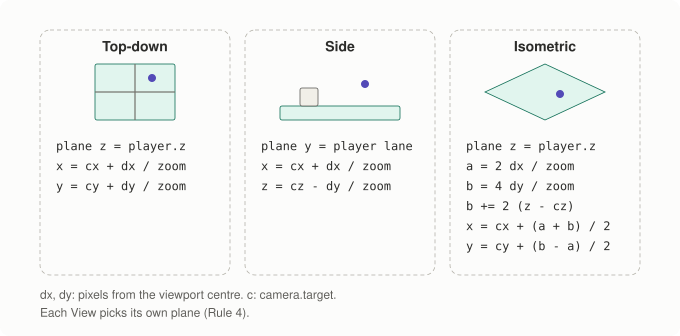
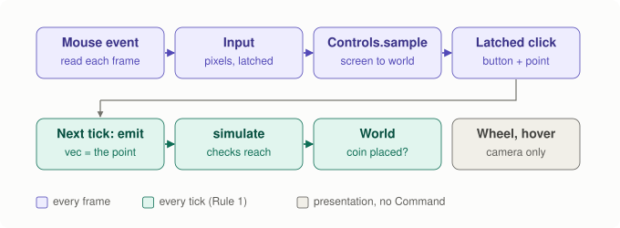
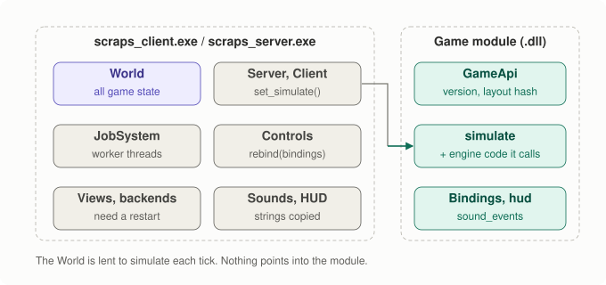

# Spec: mouse input, and hot-reloadable game code

- Date: 2026-11-12
- Status: **Approved and implemented (2026-11-12).** Reviewer: No-Go, fixed,
  then Go; bench: no measurable cost (see the results notes at the end and
  `docs/architecture.md` section 7). Questions 2 to 4
  were not answered separately, so the spec's recommendations apply: option
  B1 (the game as a DLL), the coin-placing click as the mouse demo, and hot
  reload offline and on the dedicated server.
- Plan items: `docs/plan.md`, "Next", item 4 (mouse input), plus the
  developer-workflow discussion of 2026-11-12 (edit game C++ without
  restarting).
- Diagrams: `tools/make_mouse_reload_diagrams.py` → `docs/images/spec-mr-*.svg`.

Two parts, approved together. Part A gives `Input` a mouse. Part B turns a
game's code into a module the running client and server can swap without a
restart. They touch some of the same files (`apps/client/main.cpp`, the
sandbox), and Part B's game description lists mouse bindings, so they are
built one after the other: **A, then B**, then one review and one bench.

---

## Part A. Mouse input

### What exists today

`Input` knows keys only (`is_down`, `was_pressed`). `Controls` latches key
presses per frame and emits `Command`s per tick. Views can project world to
screen (`world_to_screen`) but not back.

### A1. The pointer in `Input` (platform)

```cpp
enum class MouseButton : std::uint8_t { kLeft, kRight, kMiddle, kCount };

struct PointerPosition { float x = 0.0f; float y = 0.0f; };  // platform has no Vec2

class Input {
  // ...keys as today...
  // Pointer position in renderer output pixels (the same space as
  // Renderer2D::output_width/height and View::world_to_screen), top-left origin.
  virtual PointerPosition pointer() const = 0;
  virtual bool pointer_inside() const = 0;          // over the window this frame
  virtual bool is_down(MouseButton button) const = 0;
  virtual bool was_pressed(MouseButton button) const = 0;   // went down this frame
  virtual bool was_released(MouseButton button) const = 0;  // went up this frame
  virtual float wheel() const = 0;  // notches this frame; positive = away from the user
};
```

- **Polling, like keys.** Each frame the backend collects events into this
  state. Two clicks inside one frame (under 16 ms) count as one, which is
  fine for a game. The UI layer will later need an event list (and text
  input); that is out of scope here.
- **Pixels, not window points.** On a high-DPI screen SDL's window
  coordinates differ from render pixels; `sdl3` converts with
  `SDL_RenderCoordinatesFromWindow`, so `pointer()` always matches what
  `world_to_screen` returns.
- **headless** gets `move_pointer(x, y)`, `press(MouseButton)`,
  `release(MouseButton)` and `scroll(notches)`, latched the same way as its
  keys, for the autopilot and tests.

### A2. From screen back to world (views, Rule 4)



<details><summary>Text version</summary>

```text
cursor (pixels) ──View::screen_to_world(screen, camera, through)──► world point

            top-down              side                   isometric
plane:      z = through.z         y = through.y (lane)   z = through.z
inverse:    x = cx + dx/zoom      x = cx + dx/zoom       a = 2·dx/zoom
            y = cy + dy/zoom      z = cz − dy/zoom       b = 4·dy/zoom + 2·(z − cz)
                                                         x = cx + (a + b)/2
                                                         y = cy + (b − a)/2
(dx, dy = pixels from the viewport centre; c = camera.target)
```

</details>

```cpp
// The world point under `screen` on this view's pointer plane through
// `through` (the player, usually). Exact inverse of world_to_screen on that plane.
virtual Vec3 screen_to_world(Vec2 screen, const Camera& camera, const Vec3& through) const = 0;
```

Which plane is the View's choice, so core never learns which way is down.
Closed-form inverse of the existing projections, no allocation, no search.

Not in this part: "which block is under the cursor" (front-most block in
draw order). The level editor needs it, so it belongs in that spec.

### A3. Clicks become commands (Rule 1)



<details><summary>Text version</summary>

```text
SDL event ──► Input (pixels) ──► Controls::sample(input, view, camera, player)
                                    │  click? → View::screen_to_world → latch {button, world point}
                                    ▼
                        next tick: Controls::emit → Command{type, player, vec = world point}
                                    ▼
                        simulate (server is the authority: checks reach, may refuse)
```

</details>

- `Controls::bind(MouseButton, CommandType)` next to the key bindings
  (`kMaxBindings` grows from 8 to 12). A latched click carries the world
  point captured at press time, so a click is never lost between ticks and
  never applied twice, exactly like keys.
- `Controls::sample` gains the view, camera and the "through" point
  (`sample(input)` alone stays for key-only callers).
- The command's `vec` holds the point. **The server never trusts it**: the
  game's `simulate` decides whether the target is allowed (Rule 5).
- Wheel and hover are presentation, not commands: the wheel zooms the camera
  (in addition to `-`/`=`), and the client outlines the ground cell under the
  cursor. Neither touches the World.

### A4. The sandbox demo

- **Left click: place a coin** on the clicked ground cell, if it is within
  3 units of the player and the player holds a coin. New game command
  `kPlaceCoin = game_command(1)`. Out of reach or no coins: nothing happens
  (the server refuses; prediction may show it for a moment, then the
  snapshot corrects it, which is a good demo of reconciliation).
- Hover outline on the cell under the cursor, wheel zoom.
- The autopilot moves the pointer and clicks once (frame 250), so the
  headless smoke tests run the whole path.

### Tests (part A)

| Test | Checks |
|---|---|
| `platform.headless_pointer_latches_per_frame` | press, release and wheel are seen for exactly one frame |
| `views.screen_to_world_inverts_world_to_screen` | for all three views and many points/zooms, `world_to_screen(screen_to_world(p)) == p` within 1e-3 px |
| `views.screen_to_world_known_points` | centre of the screen → camera target projected onto the plane; hand-worked iso point |
| `controls.click_is_emitted_once` | a click in a frame with 0 ticks is emitted on the next tick, once, with its world point |
| `sandbox.place_coin_checks_reach` | in reach places a coin; out of reach or 0 coins changes nothing |
| `client_offline_*` (existing smoke tests) | autopilot click runs through every view |
| Manual (sdl3) | click, hover, wheel on a high-DPI screen and a normal one |

---

## Part B. Hot-reloadable game code

### The goal

Edit `games/sandbox/sandbox.cpp`, build one target, and see the change in
the running game in about a second: same world, same position, no restart.
This is the "Play mode" loop of Unity, for C++.

### Options

| | How | For | Against |
|---|---|---|---|
| **B1. The game as a DLL (recommended)** | `games/<game>` also builds as a shared library. The apps load it, watch the file, and swap in the new code between frames. | Fits the seam that exists (`SimulateFn` is already a plain function pointer passed to `Server` and `Client`). Works because `World` is plain data that the exe owns (Rule 5's consequence: no pointers, no callbacks), so nothing in it points into the old code. | Windows locks a loaded DLL; engine code in the exe still needs a restart; layout must match. All three are handled below. |
| B2. The engine as DLLs too | `scraps_core`, `views`, `net` become shared libraries; one copy of everything. | Engine changes could reload too. | Export macros on every engine type, a different build for everything, much more to get wrong. Not needed to iterate on a game. |
| B3. Fast restart with saved state | On exit, save the World (serialization exists); on start, load it back. | No DLLs at all; engine changes also survive. | Still a full rebuild and a new window each time (seconds, not one). A useful later addition, not a replacement. |

### B1. How it works



<details><summary>Text version</summary>

```text
┌──────────── scraps_client.exe / scraps_server.exe ─────────────┐     ┌──── scraps_sandbox_module.dll ────┐
│ owns all state: World, Server, Client, JobSystem, views,       │     │ code only, no state:              │
│ backends, Controls, SoundBank                                  │     │   GameApi { simulate, bindings,   │
│                                                                │     │             sound_events, hud }   │
│ each tick:  simulate(world&, commands, tick, jobs) ────────────┼────►│   (+ its own copy of the engine   │
│             (the World is lent, never kept by the module)      │     │    code it calls, e.g. movement)  │
└────────────────────────────────────────────────────────────────┘     └───────────────────────────────────┘
 nothing in the exe keeps a pointer into the module across a swap; strings are copied on load
```

</details>

**The game's description, one C entry point.** New header
`engine/core/game_api.h`:

```cpp
struct GameBinding { Key key; MouseButton button; CommandType command; };  // key or button

struct GameApi {
  std::uint32_t api_version;     // kGameApiVersion
  std::uint64_t layout_hash;     // kGameLayoutHash: sizes/offsets of World, Entity, Command, ...
  const char* name;              // "sandbox"
  SimulateFn simulate;
  const GameBinding* bindings; std::size_t binding_count;
  void (*sound_events)(const World& before, const World& after, PlayerId, SoundEvents& out);
  void (*hud)(const World& world, PlayerId, char* out, std::size_t size);  // "coins: 3"
};

// Every game module exports:  extern "C" const GameApi* scraps_game_api();
```

This is the game-module seam the apps need anyway: today `apps/client` and
`apps/server` name `sandbox::` directly, so a second game means editing them.
With `GameApi` they only ask "which game?". `SoundEvents` moves to core with
fixed `char[16]` names instead of `const char*`, so no string ever points
into a module that may be unloaded.

**Two ways to link the same game.** `games/CMakeLists.txt` builds the sandbox
twice from the same sources: `scraps_sandbox` (static, as today, used by
release builds, bench and tests) and `scraps_sandbox_module` (shared). The
apps link the static one and use it unless started with `--hot-game`, which
loads the module next to the exe instead.

**Loading a module.** A small new backend, `engine/backends/dynlib/`
(`LoadLibraryW`/`GetProcAddress` on Windows, `dlopen`/`dlsym` elsewhere), so
`windows.h` stays out of apps and the `layer_rules` test covers it like `udp`.
Nothing in core uses it.

### B2. The swap


<details><summary>Text version</summary>

```text
cmake --build --preset mingw-game        (builds only scraps_sandbox_module)
        │
FileWatcher (2x a second) sees the .dll change
        │  wait until size and time are unchanged for one more check (linker finished)
copy to scraps_sandbox_module.live-3.dll  (Windows locks loaded DLLs; the original stays writable)
        │
load copy → scraps_game_api() → api_version and layout_hash match?
        │ no ──► unload it, keep running the old code, HUD: "game module not reloaded: built against another engine"
        │ yes
between two frames (no tick running, no job in flight):
   server.set_simulate(api.simulate)   client.set_simulate(api.simulate)
   controls.rebind(api.bindings)       keep World, camera, sounds as they are
        │
unload the previous copy, delete its file      HUD: "game code reloaded"
```

</details>

- **When.** Only between frames on the main thread. `JobSystem::parallel_for`
  returns when every job is done, so no thread is inside module code then.
- **What survives.** Everything: the World, the camera, connections,
  prediction history. The new code simply runs from the next tick.
- **What does not hot-reload.** Engine code that lives in the exe (views,
  net, backends, the apps). Changes there still need a restart. The module
  carries its own copy of the engine code it calls (for example movement),
  and that copy does change with it.
- **The layout check.** `kGameLayoutHash` is computed at compile time from
  the sizes and key field offsets of `World`, `Entity`, `Command`,
  `CommandList` and `Level`, plus the compiler (GCC or MSVC). A module built
  after an engine struct changed is refused instead of corrupting memory.
- **Changing what data means.** If new code reads `user[2]` differently, old
  entities still hold old values. That is the game developer's call; saving
  the `.scene` file reloads the scene and starts the World fresh.
- **Memory.** The module may allocate (spawning can grow `World::entities`),
  and the exe frees later, so both must share one heap: MSVC's `/MD` runtime
  (the CMake default) and MinGW's UCRT `malloc` both do. A test spawns inside
  the module and destroys in the exe.
- **Where it runs.** Offline (server and client in one process: both swap at
  once, prediction stays exact) and the dedicated `scraps_server --hot-game`.
  A client connected to a remote server does not watch: its predictions use
  its own code, and if the server's rules changed, reconciliation corrects
  it (the server is the authority). Hot reload is a developer tool; release
  builds link the game statically.
- **Building while it runs.** The exe is running, so Windows will not let
  the linker overwrite it. New build presets `mingw-game` and `msvc-game`
  build only `scraps_sandbox_module`, so the edit-build loop never touches
  the running exe.

### Interfaces (part B)

- `engine/core/game_api.h`: `GameApi`, `GameBinding`, `SoundEvents`,
  `kGameApiVersion`, `kGameLayoutHash`.
- `engine/backends/dynlib/`: `Library::open(path, error)`, `symbol(name)`,
  closes on destruction.
- `Server::set_simulate(SimulateFn)`, `Client::set_simulate(SimulateFn)`.
- `Controls::clear_bindings()`.
- `games/sandbox/sandbox_api.cpp`: the sandbox's `GameApi` and
  `scraps_game_api()`.
- `apps/common/game_module.h`: the watcher, copy, load, check and swap
  (shared by client and server, like `scene_reload.h`).
- `CMakePresets.json`: build presets `mingw-game`, `msvc-game`.

### Tests (part B)

| Test | Checks |
|---|---|
| `game.module_matches_static` | load the built module, run 120 ticks of the side scene; the World is byte-identical to the static sandbox's |
| `game.swap_keeps_the_world` | 60 ticks, swap to a fresh copy of the module, 60 more = 120 ticks without a swap |
| `game.mismatch_is_refused` | a test module built with a wrong `api_version`/`layout_hash` is refused; the old code keeps running |
| `game.module_heap_is_shared` | an entity spawned inside the module (vector growth) is destroyed and freed in the exe |
| `game.reload_waits_for_a_stable_file` | a file still changing between two checks is not loaded yet |
| `layer_rules` | `windows.h` and `dlfcn.h` only in `backends/dynlib` |
| Manual | `--hot-game`: change the coin pickup to add 2, `cmake --build --preset mingw-game`, see the HUD count by 2 without restarting; same on msvc |

---

## Rules check

| Rule | Effect |
|---|---|
| 1. Only `simulate` changes the World | Clicks become Commands. Hover and wheel are presentation. Hot reload changes *which* simulate runs, between ticks; it never writes the World. |
| 2. Fixed step | Unchanged. Clicks are latched per frame and emitted per tick; swaps happen between frames. |
| 3. No backend in core | Pointer state comes through `Input`. DLL loading is a new backend (`dynlib`), used only by apps; core only defines the plain `GameApi` struct. |
| 4. No "down" in core | `screen_to_world` and its plane belong to each View. |
| 5. Server authority | A click's world point is a request; the game's `simulate` checks reach on the server. Online, the server's code wins. |
| Code rules | No allocation in sampling, picking or swapping per frame (loading a module allocates, once per reload). No globals: the loaded module lives in an object the app owns. No exceptions. |

## Out of scope

Text input and an event queue (needed by the UI layer), routing clicks
between UI and game, picking blocks under the cursor (level-editor spec),
hot-reloading engine code (option B2), saving state across restarts (B3),
mouse capture or relative mouse motion (no shooter yet), touch.

## Questions for the owner

1. Approve both parts as written, built in order A then B?
2. Hot reload as option **B1** (the game as a DLL), with B3 kept as a later
   idea?
3. The sandbox demo: left click places a coin within 3 units. Fine, or
   would you rather see something else on the mouse?
4. Hot reload on the dedicated server too (`scraps_server --hot-game`), or
   offline only for a start? (Recommended: both; it costs little.)

## Results, part A (2026-11-12)

Built as written, with these details settled while building:

- **The pointer plane goes through the player's feet** (`Entity::position`),
  not the camera's focus point, so on flat ground the picked point lies on
  the floor the player stands on.
- **Which cell a click means** (sandbox): the grid cell that holds the point,
  with z nudged up by 1e-3 so feet on a block top pick the cell above it. The
  cell must be empty (not solid) and inside the grid (one layer above the
  top is allowed); the coin stands at its bottom centre, which must be within
  3 units of the player. Non-finite or far-away points are refused before
  any cell index is computed. A placed coin gets the same pickup delay as a
  dropped one.
- **The hover outline** draws the twelve edges of that same cell. Top-down
  and side view fold them into a square; isometric shows a wire cube
  standing on the ground cell, i.e. where a coin would go.
- `Controls::sample(input)` (keys only) ignores mouse bindings: with no view
  there is no point to pick. Two presses of one button before a tick are one
  click, with the later point.
- The wheel zooms by 1.25 per notch, at most 4 notches a frame.
- The test groups `platform.` and `controls.` got their own CTest entries
  (`unit_platform`, `unit_controls`): 16 → 18 CTest tests. The allocation
  test now also samples, picks and emits clicks through all three views.
- The autopilot also scrolls once (frame 350), besides the click at 250.

Not verified: the `sdl3` mouse on a real window (click, hover, wheel, and
the pixel conversion on a high-DPI screen). Only the headless path ran.

## Results, part B (2026-11-12)

Built as written (option B1), with these details settled while building:

- **`apps/common/game_module.h`** holds one `GameModule` object per app:
  `use_static(api)` for the game linked into the exe (`sandbox::game_api()`;
  only the module build defines `scraps_game_api`, so the two never clash),
  `load(path)` for `--hot-game`, `install(targets)` and, once per frame,
  `poll(now, targets, message)`. `GameTargets` names the Server, Client and
  Controls to swap into (any may be null). The module path is compiled into
  the apps (`$<TARGET_FILE:scraps_sandbox_module>`, next to the exes; MSVC's
  per-config folder included); there is no option to point elsewhere.
- **Stable file**: size *and* time must be unchanged for one more check (a
  linker can grow a file within one time stamp); the file is checked again
  after the copy, and a failing copy is retried for 6 checks before the
  reload is refused. Live copies are never overwritten (a server and a
  client may watch the same build), and leftovers from a run stopped with
  Ctrl+C are deleted at the next start.
- **The client checks the file by the wall clock**, even in headless runs
  that simulate their time; a linker works in real time.
- **Bindings are re-bound only when they changed**, so a press latched in
  the frame of a swap is kept.
- **`kGameLayoutHash`** also covers MSVC's debug CRT and iterator-debug level
  (another heap, other container sizes), `sizeof(void*)`, the sizes of the
  Level's parts, and `GameApi`, `GameBinding` and `SoundEvents` themselves.
- `FileWatcher` keeps its path as a `std::filesystem::path`, so a check no
  longer allocates (the allocation test now polls a loaded module, and calls
  its HUD and sound functions every frame: 0 allocations on both compilers).
- `sandbox::sound_events` now fills a `SoundEvents&` (the `GameApi`
  signature). The HUD's "coins N" comes from the game's `hud` function.
- `--hot-game` together with `--connect` is refused with a message instead
  of being ignored.
- For the manual check, the headless autopilot now drops a coin every 360
  frames (was: once, at frame 200); in the side scene the player stands
  still then and picks it up again. Headless `--hot-game` runs print the
  game's HUD text whenever it changes.
- `layer_rules`: `dynlib` may include `windows.h` and `dlfcn.h`; `udp` lost
  its unused `windows.h` permission; `apps/` and `tests/` are scanned for
  both headers too.
- `CMAKE_POSITION_INDEPENDENT_CODE` is on (the engine's static libraries go
  into the module; needed on Linux, ignored on Windows).
- Tests: the five in the table, plus `game.static_api_describes_the_sandbox`
  and `game.sound_event_names_are_copies`; `game.swap_keeps_the_world` runs
  an offline Server and Client over a loopback hub, swaps both between two
  frames and compares both worlds with a static run. CTest: 18 → 21
  (`unit_game`, `client_offline_hot_game`, `server_hot_game`); unit tests
  86 → 93.
- Manual check, scripted (a long headless `--scene side --hot-game` run;
  the pickup edited to `+= 2`; `cmake --build --preset <x>-game`; edit
  reverted): on both `mingw` and `msvc` the running client printed
  "game code reloaded (sandbox)" and from then on each pickup added 2 to the
  same world's count. `scraps_server --hot-game` reloaded a rewritten module
  on both too.

Not verified: `--hot-game` in a windowed (`sdl3`) session; the
`dlopen` path (no Linux build); paths with non-ASCII characters.

### Review fixes (2026-11-12)

After a No-Go review:

- **The layout hash now covers source contents.** CMake hashes (SHA-256)
  every `engine/core/*.h` and `engine/platform/*.h` plus `core/jobs.cpp`
  (the module's copy of `parallel_for` drives the exe's `JobSystem`) and
  `core/world.cpp` (handle and free-list rules both sides apply to one
  World), and writes the result into a generated header
  (`build/<preset>/generated/core/boundary_hash.h`,
  `cmake/ScrapsBoundaryHash.cmake`). `kGameLayoutHash` mixes it with a
  hand-bumped `kEngineAbiVersion`, the compiler version and
  `sizeof(JobSystem)`. The files are listed with `file(GLOB ...
  CONFIGURE_DEPENDS)` and added to `CMAKE_CONFIGURE_DEPENDS`, so editing one
  re-runs configure even in a `*-game` build: the module gets the new hash
  and the running exe refuses it ("built against another engine ...;
  restart the program to use it"). The hash is over raw bytes, so a
  comment-only edit or a line-ending change also causes a refusal (the safe
  side; a restart fixes it). Other engine `.cpp` files are not hashed: the
  module carries its own copy of them, which is what hot reload is for.
  Checked by hand on both compilers: with `--hot-game` running, a comment
  added to `core/tick.h` and `cmake --build --preset <x>-game` gave the
  refusal; reverting it and building again gave "game code reloaded".
- **A swap test that proves the new code runs**:
  `game.swap_runs_the_new_code` swaps in a third test module (the sandbox
  rules plus the tick stamped into `user[3]` of every player), in the crowd
  scene, with 50 ms latency and a 2-worker `JobSystem` shared by the Server
  and the Client. Both worlds then carry the marker (the client's at its
  own newest, unconfirmed tick), and nothing else differs from a static
  run. Loading the plain sandbox in its place fails four checks; not
  swapping the Client crashes (it calls unloaded code). `Offline` sessions
  in the game tests all have the 2-worker `JobSystem` now.
- **Live copies**: a copy that fails because the target exists (another
  program took that number) moves on to the next number and deletes
  nothing. MinGW's `copy_file` checks and then creates the target without
  an exclusive open, so a race in that gap remains possible.
- **Paths are UTF-8 throughout** `GameModule` (`u8path` in, `u8string()`
  out, a UTF-8 check before converting), `FileWatcher` takes a
  `std::filesystem::path`. A test loads and reloads from a folder named
  with non-ASCII characters; with the old narrow conversion it fails on
  MSVC.
- **`GameModule::load()`** refuses when a module is loaded, and says so when
  the file does not exist.
- **`game_api.h` stops an MSVC build without `/MD`** (`#error`): the exe
  and the module must share one heap.
- **Clicks are sampled before** `-`/`=`, the wheel and `V` change the camera
  or the view.
- **`layer_rules` lower-cases** `<...>` includes before matching, so
  `<Windows.h>` is caught; `layer_rules_catch_mixed_case` checks it on a
  generated tree.
- **Hints for a module that never reloads**: `--hot-game` prints which file
  it watches and the exact command that rebuilds it for this program's
  configuration (also on the HUD for 8 s); a missing module names that
  command. With Visual Studio, the apps also watch the other
  configurations' module files: building the Debug module while a Release
  exe runs prints "game module not reloaded: .../Debug/... was rebuilt, but
  this program reloads only .../Release/..." (checked by hand). The
  `msvc-game` preset already builds Release, like `msvc`.
- **PDB lock (MSVC)**: Release links write no PDB. In a Debug or
  RelWithDebInfo build with a debugger attached, the debugger keeps the
  module's `scraps_sandbox_module.pdb` open, and the next link can fail
  writing it (LNK1201). Detach, or iterate in Release. Not worked around.
- **One rule for "which cell holds this point"**: `core/level.h`
  `cell_at_point()`, used by the sandbox's coin placing and the client's
  hover outline (it does not name `sandbox::`). It is in core because both a
  game rule on the server and the client need it with no View at hand; the
  1e-3 nudge is a tie-break on z, which core already defines as height, and
  assumes no gravity.
- The allocation test's module copy could silently stay stale (MinGW's
  `copy_file` with `overwrite_existing` failed and the error was ignored);
  it now deletes, copies and checks. It also polls two other-build
  watchers.
- CTest: 21 → 23 (`boundary_hash_tracks_sources`,
  `layer_rules_catch_mixed_case`); unit tests 93 → 98.
