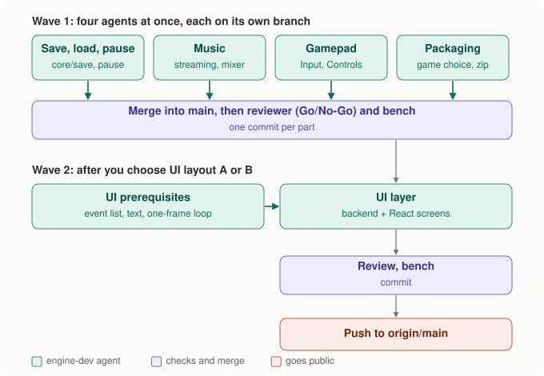
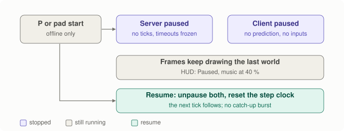

# Spec: offline essentials, and the UI layer

- Date: 2026-11-14
- Status: **Approved by the owner (2026-11-14), being built.** Answers: parts 1
  to 5 approved as written; UI **layout A (WebView2)**
  (`docs/decisions/2026-11-14-ui-layout.md`); P pauses and Esc quits until the
  UI has a pause menu; one commit per part on `main`, then push to `origin/main`.
- Asked for: "finish implementing all of this": save and load, music, gamepad,
  pause, packaging a release, and the UI layer. Plan it, divide it among agents,
  then commit and push.
- Diagrams: `tools/make_offline_ui_diagrams.py` → `docs/images/spec-ou-*.svg`.

Six parts. Parts 1 to 5 are engine work that every game reuses, and they are
independent of each other, so four agents build them in parallel, each in its
own git worktree (wave 1). Part 6, the UI layer, needs your choice between
layout A and layout B, and it builds on wave 1, so it comes second (wave 2).

## The build plan



<details><summary>Text version</summary>

```text
pre-step (me): Key gains P, F5, F9 (so agents don't all edit the same enum)

wave 1, parallel, each agent in its own git worktree / branch
  ├─ agent 1: save and load + pause      (core/save, Server/Client pause, client keys)
  ├─ agent 2: music                      (streaming decoders, mixer music channel, scene "music")
  ├─ agent 3: gamepad                    (Input, sdl3, headless, Controls, GameApi v2)
  └─ agent 4: packaging + game choice    (SCRAPS_GAME, scene lookup, install, CPack zip)
merge into main (me) ─► reviewer (Go/No-Go) ─► bench ─► commit each part

wave 2, after your A/B choice
  agent 5: UI prerequisites   (input event list, text input, client loop as one frame)
  agent 6: UI layer           (backend for A or B, React screens)
reviewer ─► bench ─► commit ─► push to origin/main
```

</details>

Each agent works on its own branch, so none can overwrite another's files.
The files several parts touch (`apps/client/main.cpp`, `games/sandbox`) get
small, separate edits that I merge. Every part must, on its own branch, build
on `mingw` and `msvc` with zero warnings and pass `ctest`.

---

## Part 1. Save and load

**What:** write the game to a file and read it back, from a key or later a
menu. Each game reuses this; it decides only *when* to save.

- **What's in a save:** the World's state (entities, tick, random state,
  players), as snapshots already serialise it (`write_world_state`), with a
  header: magic `SCRS`, save-format version, scene name, scene content hash,
  tick, and the game's name. The level is not stored; it comes from the scene
  file, as on every start.
- **New in core:** `core/save.h`. `write_save(world, scene_name, scene_hash,
  game_name, bytes)` and `read_save(bytes, header, world_from_scene, error)`.
  Reading starts from the World built from the scene and overlays the saved
  state, so rules and level stay the scene's.
- **Who saves (Rule 5):** the server, because it holds the true World.
  Offline that is the embedded server. `Server::world()` is read-only.
- **Loading (Rule 1):** like hot reload, it is construction, not mutation.
  `Server::load_state(World)` replaces the World between ticks, and clients
  get a new Welcome and a full snapshot.
- **Checks:** wrong magic or version, or a different scene name: refused with
  a message. Same scene name but a changed scene file (another hash): loaded,
  with a HUD warning, because levels change during development.
- **Where:** `SDL_GetPrefPath("Scraps", <game>)` (on Windows,
  `%APPDATA%\Scraps\<game>\`); with no SDL (headless), `./saves/`. One slot
  for now, `quick.sav`. The app decides the path; core only turns bytes into a
  World and back.
- **Keys (offline only):** F5 saves, F9 loads. The dedicated server gets
  `--load <file>`, and `--save <file>` on clean shutdown.
- **Tests:** a save round-trips byte for byte; a truncated, corrupted or
  other-version file is refused; another scene is refused; a changed scene
  warns. Offline: play, save, play on, load, and the World equals the saved
  one. After a load, the client's prediction restarts from the new snapshot.

## Part 2. Music

**What:** background music in any common format, looping, with fades. Today
sounds are capped at 30 s, because they are decoded completely into memory.
A 3-minute song would be about 70 MB decoded, so music has to stream.

- **Streaming in core:** `core/music.h`, `MusicStream`. It opens OGG, MP3,
  FLAC or WAV (recognised by content, like sounds) with the pull decoders
  already vendored (stb_vorbis, dr_mp3, dr_flac, dr_wav). It decodes a few
  thousand frames at a time, converts to 48 kHz stereo, and wraps to the
  start when looping. All buffers are sized when the stream opens, so mixing
  allocates nothing.
- **Mixer:** a music channel next to the effect voices. `play_music(stream,
  volume, fade_in)`, `stop_music(fade_out)`; starting a new track crossfades.
  `music_volume` is separate from effects.
- **Scenes:** `music <path> [volume V]` plays when the scene loads, and keeps
  playing across hot reloads if the path is unchanged.
- **Decoding runs on the main thread** while mixing ahead, as effects do now:
  about 60 ms of audio per frame, well under a millisecond.
- **Sandbox:** `tools/make_sandbox_sounds.py` composes a short original
  chiptune loop (about 30 s) as `music.ogg`. Every scene plays it.
- **Tests:** for each format, the first seconds streamed equal the same file
  fully decoded; a loop wraps with no gap or click; crossfade volumes follow
  the curve; mixing with music allocates nothing; a missing or broken file
  gives an error, never a crash.

## Part 3. Gamepad

**What:** play with a controller. Input gets the first connected gamepad;
local multiplayer with several pads is out of scope.

- **`Input`:** `GamepadButton` (south, east, west, north, d-pad, start, back,
  shoulders, stick clicks), `GamepadAxis` (left x/y, right x/y, triggers),
  `gamepad_connected()`, and button down, pressed and released this frame,
  latched like keys. Axes are −1..1, raw; the dead zone belongs to Controls.
- **sdl3:** `SDL_INIT_GAMEPAD`. Open a pad when it is added, close it when it
  is removed. Button names follow SDL's positional layout (south = A on
  Xbox, Cross on PlayStation).
- **headless:** `set_axis` and `press/release(GamepadButton)` for the
  autopilot and tests.
- **Controls:** the left stick moves like WASD but analog (Move's `vec` may
  already be shorter than 1), with a radial dead zone of 0.2. The d-pad acts
  as WASD, south jumps, and start toggles pause (Part 4).
- **`GameApi` version 2:** `GameBinding` can name a gamepad button. Version 1
  modules are refused with the usual message. The sandbox binds west to
  "drop coin".
- **Tests:** stick to move direction in all three views; the dead zone; a
  tap between ticks is emitted exactly once; a pad connected mid-game; d-pad
  equals WASD.
- **Not verifiable here** without a controller plugged in: the sdl3 path is
  checked by hand by you.

## Part 4. Pause

**What:** stop the game and resume exactly where it was. Offline only; in
an online game one player can't stop everyone else's world. That would be a
design decision per game, and the server would own it.



<details><summary>Text version</summary>

```text
P / gamepad start ─► app: paused = !paused
paused:   Server::set_paused(true)   no ticks, no snapshots, client timeouts frozen
          Client::set_paused(true)   no prediction, no inputs sent, server timeout frozen
          FixedStepClock stops counting; frames keep drawing the last world; music ducks to 40 %
resume:   both unpause, clock.reset()  ─► next tick is the one after the paused tick (no burst)
```

</details>

- **Rule 2 holds:** a pause adds no "slower" ticks. Ticks stop, then
  continue with the next tick number. The clock is reset on resume, so it
  doesn't try to catch up on the paused time.
- **Why the server needs to know:** without it, a paused client sends no
  input, and after 5 s the server drops it as gone. So both sides freeze
  their timeouts.
- **Shown:** "Paused" on the HUD (until the UI layer draws a pause menu).
  Music ducks to 40%. Effects that are already playing finish.
- **Tests:** 10 simulated seconds of pause give no ticks and no disconnect.
  Pause and resume give, after N ticks of play, a World byte-identical to a
  run that never paused. Resuming runs no burst of ticks. Online, the client
  ignores pause.

## Part 5. Packaging a release, and choosing the game

**What:** one command makes a zip that runs on a clean Windows PC, and the
apps can be built for any game under `games/`.

- **Choosing the game:** CMake option `SCRAPS_GAME` (default `sandbox`). A
  helper `scraps_add_game(<name> SOURCES ... SCENES <dir>)` makes the static
  library, the hot-reload module and the scene-folder setting. Apps include
  one generated header that returns the chosen game's `GameApi`, so
  `apps/*/main.cpp` no longer name the sandbox. A second game is a new folder
  plus `-DSCRAPS_GAME=<name>`.
- **Finding scenes at run time:** in order, `--scene-dir`, then `scenes/`
  next to the exe, then the source folder compiled in for development.
  Today only the last exists, which breaks on another PC.
- **`cmake --install` and CPack:** the zip holds `scraps_client.exe`,
  `scraps_server.exe`, `SDL3.dll`, the compiler's runtime DLLs (MinGW:
  `libstdc++-6`, `libgcc_s_seh-1`, `libwinpthread-1`, found with
  `file(GET_RUNTIME_DEPENDENCIES)`; MSVC: the VC runtime through
  `InstallRequiredSystemLibraries`), the game's `scenes/` with art, sounds
  and music, and a short `README.txt`. It is named
  `Scraps-<game>-<version>-win64.zip`.
- **Presets:** `cmake --workflow --preset release-mingw` (and
  `release-msvc`) configure, build, test and package in one go.
- **Release builds** link the game statically. No hot-reload module and no
  `--hot-game` in the zip.
- **Test:** `package_runs` installs into a temp folder and runs
  `scraps_client --headless --frames 120` from there, with `PATH` cut down to
  Windows' own folders. If a DLL is missing, it fails.

---

## Part 6. The UI layer (needs your choice)

**What:** menus and HUD written in React/HTML/JS, in a native exe. The first
version has: a main menu (Play, Continue = load, Quit), a pause menu
(Resume, Save, Load, Settings, Quit), the HUD (coins), and settings (music
and effects volume). It shows both kinds of UI action: game actions become
`Command`s (Rule 1), for example a "drop coin" button, and app actions such
as save, pause and quit call the app.

**Prerequisites for both layouts (agent 5):**
- `Input` gains an event list per frame (key, button, text, pointer, pad),
  plus text input on and off, so a text field gets typed characters.
- The client loop becomes a one-frame function, `ClientApp::frame(now)`, so
  a host that owns the window loop (a WebView or browser engine) can call it.
- A `UiBridge` interface: the app sends a small JSON "view model" (coins,
  paused, menu state) when it changes, and receives UI actions by name.


<details><summary>Text version</summary>

```text
A. WebView draws everything                         B. HTML overlay on native rendering
┌──────── WebView2 window ────────┐                  ┌────────── sdl3 window ───────────┐
│ React: menus, HUD (DOM)         │                  │ world: SDL GPU (as today)        │
│ WebGL canvas: the world         │                  │ + texture of the UI bitmap       │
│   ▲ triangle batches + textures │                  │       ▲ offscreen browser engine │
└───┼─────────────────────────────┘                  └───────┼──────────────────────────┘
    │ shared memory (no JSON per frame)                       │ Ultralight (free for small indie, closed)
native engine: simulate, server, net, audio, Views            │ or CEF (open, ~150 MB, multi-process)
```

</details>

| | A. WebView2 draws everything (recommended) | B. Native world, HTML overlay |
|---|---|---|
| How | New backend `webview2`: a Win32 window with a WebView2 control implements Window, Input and Renderer2D. `fill_triangles` batches and textures go to WebGL2 through a `CoreWebView2SharedBuffer`; React is in the same page. Audio stays native (SDL audio only). | Keep `sdl3`. Render React offscreen with Ultralight or CEF into a bitmap; `Renderer2D` gains `update_texture`; draw it over the world; route input to the UI first, the game second. |
| Reuse | All three Views unchanged: they already reduce everything to triangle batches and textures, which is all `Renderer2D` is. | Everything unchanged; the UI is added on top. |
| Dependencies | WebView2 runtime is part of Windows 11 (installed here, version 157); WebView2 SDK (MIT, NuGet). Node for building the React app (installed: Node 20). | Ultralight: closed source, free under a revenue limit, about 40 MB. CEF: open, about 150 MB, several processes. Plus Node. |
| Developer experience | Edge DevTools (F12) on the real game UI; Vite hot reload of React while the game runs. | DevTools only through a remote inspector; harder. |
| Costs | Windows only for the React build (the `sdl3` build stays as it is, without React UI). About one more frame of display latency through the browser compositor. | A big binary dependency; the UI bitmap is copied to the GPU every frame it changes; more glue code for input routing. |
| Rules | A new backend (Rule 3); UI actions are Commands (Rule 1). | The same. |

**Recommendation: A.** `Renderer2D` is only "textures plus triangle batches",
so a WebGL backend is small, and the world looks exactly as it does now.
Nothing proprietary or 150 MB is added, and React gets real browser tools.
The price is Windows only for the React UI, which matches how you ship
today.

**Agent 6 builds the chosen layout:**
- the backend;
- a `ui/` React app (Vite + TypeScript), built into `ui/dist` and shipped in
  the zip;
- the four screens above;
- tests: the bridge's JSON and actions, a UI action becoming a Command, and
  for A, the shared-buffer batch format round-trips.

The window itself is checked by hand by you.

---

## Rules check

| Rule | Effect |
|---|---|
| 1. Only `simulate` changes the World | Gamepad and UI game actions are Commands. Loading a save replaces the World between ticks, as a scene reload does (construction). Pause stops ticks; it never edits the World. |
| 2. Fixed step | Pause stops ticks and resets the clock; there is no variable step. Music streams by frame, like effects. |
| 3. No backend in core | Save, music decoding and mixing are pure core code. The gamepad comes through `Input`. The save folder and the UI are backends or apps. |
| 4. No "down" in core | The stick maps through the View, as WASD does. |
| 5. Server authority | The server saves and loads. Pause is offline only, and the server knows about it. |
| Code rules | No allocation per frame (streaming buffers are sized when a stream opens), no globals, no exceptions in core. |

## Out of scope

Several save slots and save thumbnails, cloud saves, local multiplayer with
several pads, rumble, rebinding controls in a menu, online pause or voting,
an installer (.msi), code signing, auto-update, macOS and Linux packages,
localisation.

## Questions for you

1. Approve parts 1 to 5 as written, built in parallel by four agents?
2. **UI: layout A (WebView2, recommended) or B (overlay)?** If B: Ultralight
   or CEF?
3. Esc: today it quits. With the UI, Esc should open the pause menu. Until
   then, P pauses and Esc still quits. Fine?
4. Push target: commit each part, then push to `origin/main`
   (`github.com/DuongDH03/gamers`) when everything is done. Or would you
   rather have a branch and a pull request?

## Results, part 3: gamepad (2026-11-14)

Built as written, with these details settled while building:

- **`Input`** gained `GamepadButton` (positional: south, east, west, north,
  d-pad, start, back, shoulders, stick clicks), `GamepadAxis` (left/right
  x/y, triggers), `gamepad_connected()`, `is_down` / `was_pressed` /
  `was_released` per button and `axis()`. Sticks use screen conventions
  (x right and y down are +1), triggers 0..1, raw. A tap inside one frame is
  both pressed and released in it, like a mouse click. No pad: every button
  up, every axis 0.
- **sdl3:** `SDL_INIT_GAMEPAD` is optional, like audio: if it fails the game
  runs without a pad. A pad already plugged in when the window opens is
  opened at once; `SDL_EVENT_GAMEPAD_ADDED` opens one if none is open;
  removing the open pad closes it and opens another that is still connected.
  Events from other pads are ignored. Focus lost clears the pad state, as for
  the mouse. **Also:** on focus gained the pad's held buttons and axes are
  read again (without "pressed"), so a stick held while switching back
  counts. Guide, paddles, touchpad and misc buttons are ignored.
- **headless:** `connect_gamepad(bool)`, `press/release(GamepadButton)`,
  `set_axis(GamepadAxis, float)`, all taking effect at the next frame.
  Presses and axes on an unplugged pad are ignored; unplugging lets go of
  everything without a "released". Axes are clamped to their range; not
  finite counts as 0.
- **Controls:** the left stick goes through a radial dead zone of 0.2,
  rescaled so the output starts at 0 at its edge
  (`Controls::apply_dead_zone`), then through the View like WASD, scaled by
  how far it is pushed: Move's `vec` has length ≤ 1. **Choices made here:**
  - A held movement key or d-pad direction wins over the stick (full speed,
    the keys' direction); the stick is used only when no direction key is
    held. Keys and stick are not added together.
  - Side view: only the sideways part of the push counts (the stick pushed
    mostly up walks slowly, not at full speed). Controls finds out by asking
    the View which screen axes have a ground direction
    (`screen_to_ground_direction` of (1, 0) and (0, 1)), so it still knows
    nothing about "down" (Rule 4).
  - The d-pad is WASD, including "d-pad up jumps" in the side view, like W.
    Pushing the stick up does not jump (it would make every slightly upward
    push a jump). South jumps in every view, like Space.
  - `bind(GamepadButton, CommandType)` shares the 12 slots with keys and
    mouse buttons and is latched once per tick the same way.
  - **Start is not wired to pause** on this branch: it is an ordinary
    `GamepadButton::kStart`. Part 4 owns pause and connects it at the merge.
- **`GameApi` version 2:** `GameBinding` gained a `pad` field (last, so the
  first three fields keep their places) and `pad_binding()`. A binding names
  exactly one of key, mouse button and gamepad button, each in range; the
  apps check that (`check_game_api`), install it into Controls and compare it
  when deciding whether a reload needs a rebind. A version 1 module is
  refused with the usual message ("built against another engine (game API
  version 1, this program has 2)"). The layout hash also mixes
  `offsetof(GameBinding, pad)`.
- **Sandbox:** west (X on Xbox, Square on PlayStation) drops a coin. The
  test marker module got the same binding.
- **Client:** Controls get the pad through `Input` as before (nothing else to
  pass); the HUD says "gamepad connected" (or "disconnected") for 3 s when the
  pad comes or goes, and prints it on the console too. The help line and
  `--help` name the pad controls. The headless autopilot plugs a pad in from
  frame 450 to 569 (stick circling, south at 470, west at 500), so every
  `client_offline_*` smoke test runs the pad path. Movement keys are held all
  through the autopilot, so the stick does not change where the walk ends.
- **Tests** (98 → 106 test functions; still 23 CTest tests):
  `platform.headless_gamepad_latches_per_frame`,
  `controls.stick_dead_zone_is_radial_and_rescaled`,
  `controls.stick_moves_the_way_it_is_pushed_in_every_view` (full and half
  push, six directions, three views, and keys win over the stick),
  `controls.dpad_equals_wasd` (all 16 combinations, three views),
  `controls.gamepad_tap_between_ticks_is_emitted_once`,
  `controls.gamepad_binding_emits_its_command`,
  `controls.gamepad_connected_mid_game`,
  `game.gamepad_bindings_are_checked_and_installed`. `game.mismatch_is_refused`
  has a third refused module that claims version 1 and checks the message
  names it. `no_allocation_in_hot_path` also samples a pad (stick across the
  dead zone, south and west pressed now and then): still 0 allocations.

Not verified: the `sdl3` gamepad with a real controller. Only the headless
path ran. To check by hand (`scraps_client`, any scene): plug a pad in while
the game runs (HUD: "gamepad connected"); the left stick walks in the
direction pushed in all three views (V switches), slowly when pushed a
little, not at all when resting; the d-pad walks like WASD; A / Cross jumps;
X / Square drops a coin when you hold one; in the side view d-pad up jumps.
Switch to another window while holding the stick and come back: the player
must not keep walking after you let go. Unplug the pad (HUD: "gamepad
disconnected", the player stops); with two pads, unplug the one in use and
the other takes over.
---

## Results, parts 1 and 4

Built 2026-11-14 on branch `worktree-agent-a7919aa9ccb12285f` (agent 1).
`mingw` and `msvc` both build with zero warnings, and `ctest` passes 28 of 28
on both (114 unit test functions, 16 of them new).

**What was built**
- `core/save.h`: `write_save`, `read_save_header`, `read_save`. Format:
  magic `SCRS`, version 1, game name, scene name, scene hash, tick, the state
  size, the state (`write_world_state`), and an FNV-1a checksum of
  everything before it. `read_save` lays the state over the World built from
  the scene, and returns `kRefused` (with a message, World untouched),
  `kLoaded`, or `kSceneChanged` (loaded, warn).
- `Server`: `world()` (it already existed, read-only), `scene_name()`,
  `scene_hash()`, `load_state(World, scene name, hash)`, `set_paused`.
  `reload` and `load_state` share one private `replace_world`.
- `Client::set_paused`. `FixedStepClock::reset()`.
- `apps/common/save_game.h` (file I/O: write to `.tmp`, then rename) and
  `apps/common/pause.h` (`OfflinePause`: the one place that pauses; it
  refuses online). `sdl3::preferences_path` wraps `SDL_GetPrefPath`.
- `scraps_client`: F5 and F9 (offline) use `quick.sav` in
  `SDL_GetPrefPath("Scraps", <game>)`, or in `./saves/` when headless; P pauses
  (offline); HUD messages for saved, loaded, errors and the changed-scene
  warning, and a centred "Paused - P to resume". `// TODO(merge): duck music`
  marks where part 2's mixer ducks.
- `scraps_server --load <file>` (the save's scene unless `--scene` is
  given) and `--save <file>` (after the loop ends).

**Tests.**
- `unit_save`:
  - format: a byte-for-byte round trip; the header; every truncation refused;
    every single-byte corruption refused; another version, scene or game
    refused; a changed scene loads with a warning.
  - offline: play, save, play on, load, and the World equals the save, tick
    included; prediction restarts after a load over 50 ms latency; saved
    players who are not here are removed; a refused load changes nothing.
- `unit_pause`: 10 simulated seconds with no ticks, no snapshots, no inputs and
  no disconnect (also with the server polled while paused); byte-identical to a
  run that never paused; no burst after resuming (50 Hz frames, and a 3 s stall
  while paused); `reset()`; online, the client ignores pause.
- Smoke tests:
  - `server_save` → `server_load`: tick 30 saved, world tick 60 after 30 more.
  - `client_offline_save_pause_load`: the headless autopilot presses F5, P, P,
    F9 and prints "saves 1, loads 1, save errors 0, paused frames 60, ticks
    while paused 0".
- `no_allocation_in_hot_path` also pauses an offline game for 600 frames and
  resumes it: 0 allocations.
- Mutation check: with the server's timeout freeze or the client's "world
  replaced" handling turned off, `pause.ten_seconds_...` and
  `save.offline_save_play_load` fail.

**Deviations, and why**
- **`load_state` takes the scene name and hash too**, like `reload`. The
  World is built from the scene file as it is now. If that file changed after
  the server loaded it, clients must be told the new hash, or they would
  refuse it.
- **A load keeps the saved tick** (reload keeps the running one), so the
  World equals the saved one. The client ignores the Welcome (same scene).
  It notices the load in the next full snapshot, whose tick is lower than the
  newest one it has. That only happens after a load, because snapshots
  complete in order. The client then clears its interpolation samples and
  starts prediction over without blending. No protocol change.
- **Saved players who are not playing now are removed at the next tick.**
  Players who are playing keep their saved entity (a join of a player who
  already has one changes nothing). Rejoining players can't be matched to
  saved ones yet, so after `--load` a dedicated server keeps no players.
- **A save from another game is refused too**, not only one for another scene.
- **A checksum** was added to the header, so corruption is always caught,
  not only when the state happens to fail validation.
- **F9 resumes a paused game**, so the loaded world shows at once.
- **The headless autopilot now presses F5 (frame 240), P (frames 270 and 330)
  and F9 (frame 420)** in every offline smoke run of 600 frames. Those runs
  write `saves/quick.sav` in their working folder (the `apps` build folder).
  The dedicated test runs in a folder of its own. Under `ctest -j` the other
  smoke runs could read each other's save; they don't fail on that, and only
  the dedicated test checks the counts.

**Not done, or not verified**
- The SDL path (`%APPDATA%\Scraps\sandbox\quick.sav`) and the HUD text were
  not seen in a window; only the headless path ran.
- `--save` runs only when the loop ends (`--ticks`). Ctrl+C stops the server
  without saving. Catching Ctrl+C needs a signal flag, which is global state,
  so that is the owner's call.
- No music ducking and no gamepad start button (parts 2 and 3; see the merge
  TODO).
---

## Results, part 5 (packaging a release, and choosing the game)

Built 2026-11-14 on its own branch (wave 1, agent 4).

**What exists now**

- `cmake/ScrapsGame.cmake`: `scraps_add_game(<name> SOURCES ... SCENES <dir>
  [DEFAULT_SCENE s] [HEADER h] [API_FUNCTION f] [INCLUDE_DIR d] [README f])`
  makes `scraps_<name>` (static), `scraps_<name>_module` (hot reload) and
  `scraps_<name>_app`, a small library with the generated `selected_game.h`
  and `.cpp` (templates `cmake/selected_game.*.in`). `selected_game()` gives
  the name, default scene, source scenes folder and the hot-reload paths;
  `selected_game_api()` the `GameApi`. `games/CMakeLists.txt` is now one call.
- `SCRAPS_GAME` (cache string, default `sandbox`) picks the game;
  `scraps_select_game()` refuses an unknown name and lists the known ones.
  `apps/*/main.cpp` no longer include `sandbox/sandbox.h`; bench and tests
  still use the sandbox directly. `scraps_add_client()` /
  `scraps_add_server()` (apps/CMakeLists.txt) build the apps for any game.
- The `mingw-game` / `msvc-game` presets build `scraps_game_module`, a
  target that depends on the selected game's module (presets cannot read a
  cache variable). Checked live: a running `scraps_server --hot-game`
  printed "game code reloaded (sandbox)" after `cmake --build --preset
  mingw-game`; `msvc-game` builds.
- Scenes at run time (`apps/common/scene_dir.h`): `--scene-dir`, then
  `scenes/` next to the exe, then the source folder. Both apps print
  `game '<name>', scenes from <dir> (<which rule>)` at start-up. The exe's
  folder comes from `dynlib::executable_directory()` (GetModuleFileNameW;
  `/proc/self/exe` elsewhere), because only `backends/dynlib` may include
  `windows.h`.
- `SCRAPS_HOT_RELOAD` (default ON). Off, the apps answer `--hot-game` with
  "--hot-game is not available in this build" (exit 2), and the hot-game
  smoke tests become `client_hot_game_unavailable` /
  `server_hot_game_unavailable`.
- `cmake/ScrapsPackage.cmake`: install rules and CPack (ZIP,
  `Scraps-<game>-<version>-win64.zip`, one top folder of the same name, in
  `build/<preset>/package/`). `cmake/ScrapsInstallRuntime.cmake` runs
  `file(GET_RUNTIME_DEPENDENCIES)` at install time with the compiler's bin
  folder searched before PATH, drops `api-ms-*`/`ext-ms-*` and anything under
  `C:\Windows\`, and fails the install on an unresolved or conflicting DLL.
  MSVC adds `InstallRequiredSystemLibraries`. `README.txt` comes from
  `cmake/README.txt.in` plus the game's own notes (`games/sandbox/README.txt`),
  with CRLF line ends.
- Presets file version 6 (needs CMake 3.25; 4.0.1 is installed):
  configure/build/test/package presets and workflows `release-mingw` and
  `release-msvc` (`build/release-mingw`, `build/release-msvc`,
  `SCRAPS_HOT_RELOAD=OFF`).
- Tests: `unit_apps` (4 functions: the three scene-folder rules, and that
  `executable_directory()` holds the test exe); `package_runs` (label
  `package`, about 2 to 7 s, so it stays in the default run): installs into
  `build/<preset>/tests/package_work/install`, checks the files and that no
  module was installed, then with `PATH=C:\Windows\System32;C:\Windows` runs
  `scraps_client --headless --frames 120` from another folder (it must say
  its scenes came from the install) and `scraps_server --ticks 30`;
  `tiny_game_runs`: `tests/tiny_game` is a second game (engine rules, one
  scene, HUD "tiny game") added with `scraps_add_game`, and
  `scraps_client_tiny` is the same client source built for it.

**Zips** (`cmake --workflow --preset release-mingw` / `release-msvc`)

| | release-mingw | release-msvc |
|---|---|---|
| File | `Scraps-sandbox-0.1.0-win64.zip`, 3,629,551 bytes | `Scraps-sandbox-0.1.0-win64.zip`, 2,067,697 bytes |
| Executables | `scraps_client.exe` 6.3 MB, `scraps_server.exe` 0.8 MB | `scraps_client.exe` 3.2 MB, `scraps_server.exe` 0.2 MB |
| Runtime DLLs | `libstdc++-6`, `libgcc_s_seh-1`, `libwinpthread-1` | `vcruntime140`, `vcruntime140_1`, `msvcp140`, `msvcp140_1`, `msvcp140_2`, `msvcp140_atomic_wait`, `msvcp140_codecvt_ids`, `concrt140` |
| Also | `README.txt`, `scenes/` (4 scenes, `art/` 10 PNGs, `sounds/` 3 files) | the same |

Each zip was unzipped into an empty folder and run from another folder with
`PATH=C:\Windows\System32;C:\Windows`: the client headless (120 frames, and
600 in `side`), the server for 30 ticks, all exit 0 with images and sounds
loaded from the zip's `scenes/`; `--hot-game` said it is not available.
With `libstdc++-6.dll` removed from a MinGW install the client exits at once
with `0xc0000135` (no dialog box), which is how `package_runs` fails.

**`-DSCRAPS_GAME=tiny`** (a headless MinGW build in `build/tiny-headless`):
`scraps_client --headless --frames 120` and `scraps_server --ticks 30` run
the tiny game in its `field` scene, and `--hot-game` loads
`scraps_tiny_module.dll`.

**Test results** (26 CTest tests, 102 unit test functions)

| | Build | ctest |
|---|---|---|
| `mingw` | 0 warnings | 26/26 passed |
| `msvc` | 0 warnings | 26/26 passed |
| workflow `release-mingw` | 0 warnings | 26/26 passed, zip made |
| workflow `release-msvc` | 0 warnings | 26/26 passed, zip made |

**Deviations from the text above**

- **No `SDL3.dll`.** The bundled SDL3 is built as a static library
  (`cmake/ScrapsSDL3.cmake`), so there is nothing to ship. If a shared SDL3
  is found installed instead, the runtime-dependency step ships its DLL.
- **The hot-reload module is still built in release build trees**, because
  `unit_game` and the allocation test load it; it is never installed, and
  `package_runs` checks that. With `SCRAPS_BUILD_TESTS=OFF` and
  `SCRAPS_HOT_RELOAD=OFF` it is not built at all.
- **The default scene moved into the game** (`DEFAULT_SCENE`, else the first
  `.scene` file), since "isometric" is the sandbox's. The sandbox's four
  named smoke tests run only when `SCRAPS_GAME` is `sandbox`; another game
  gets `client_offline_default`.
- **The tiny game builds only with tests on** (it lives in `tests/`), so
  `-DSCRAPS_GAME=tiny` needs `SCRAPS_BUILD_TESTS=ON` (the default).
- **README keys** list what exists on this branch. Pause (P), quick save and
  load (F5, F9) and the gamepad come from parts 1, 3 and 4; add them to
  `cmake/README.txt.in` when merging.
- `workflow` presets cannot pass `-D` options, so to reuse an SDL3 source
  folder, configure the preset once with `-DFETCHCONTENT_SOURCE_DIR_SDL3=...`
  and then run the workflow, which keeps the cache.

**Not verified:** a really clean Windows PC. On this one the VC runtime is
also in `System32`, so the minimal-PATH run proves the MinGW DLLs are
complete but not the MSVC list (the zip carries the VC runtime next to the
exe, which Windows loads first). The SDL3 window from an unzipped release was
not opened (headless runs only).
